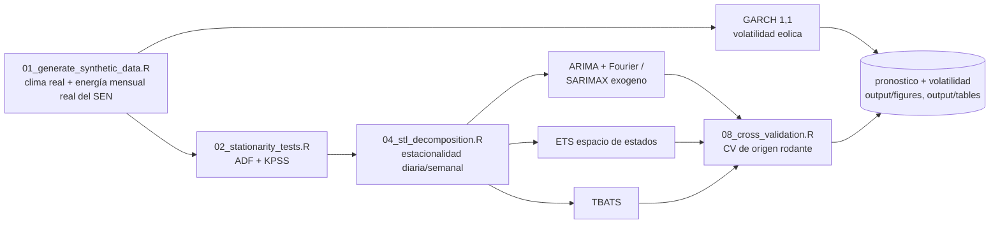

<div align="center">

# ⚡ Pronóstico Estadístico de Demanda Energética y Estabilidad de Red en el SEN Chile

**Un proyecto de extremo a extremo en R -- ARIMA/SARIMAX, descomposición STL, modelos de espacio de estados (ETS) y GARCH -- sobre el ecosistema tidyverts/fable**

🌐 **[Español](README.es.md)** | **[English](README.md)**

[](https://www.r-project.org/)
[](https://fable.tidyverts.org/)
[](https://cran.r-project.org/package=forecast)
[](https://cran.r-project.org/package=rugarch)
[](LICENSE)

</div>

---

## 1. Título del proyecto

**Pronóstico Estadístico de Demanda Energética y Estabilidad de Red en el Sistema Eléctrico Nacional (SEN) de Chile**

Repositorio: [`chile-energy-grid-forecasting-r`](https://github.com/Rxyxs/chile-energy-grid-forecasting-r)

## 2. Motivación

Me interesa este problema porque combina dos cosas que rara vez conviven en un solo dataset: series de tiempo con estacionalidad múltiple genuina (diaria, semanal, anual) y un componente de volatilidad real que importa operacionalmente, no solo estadísticamente. El Coordinador Eléctrico Nacional (CEN) es responsable de la coordinación en tiempo real y la planificación de largo plazo del SEN, que abastece a la gran mayoría de Chile continental. Dos tensiones estructurales hacen que el pronóstico riguroso importe ahí:

- **Creciente penetración solar y eólica.** Chile tiene una de las mayores irradiancias solares del mundo (Atacama) y un parque eólico en expansión, especialmente en el norte y el sur del país. Esa generación es intermitente por naturaleza: cae a cero en la noche (solar) y varía con el viento en rachas que se agrupan en el tiempo (clustering de volatilidad), no de forma independiente hora a hora.
- **El costo de una falla de red no es lineal.** Una rampa de demanda neta mal anticipada (el clásico problema de la "curva de pato": la demanda neta sube abruptamente cuando cae la generación solar al atardecer) obliga a activar reservas de generación rápida con poco preaviso, y en el peor caso deriva en desbalance de frecuencia.

Este proyecto construye el stack estadístico completo para abordar ambos problemas con las herramientas correctas para cada uno: modelos ARIMA/SARIMAX y de espacio de estados para el nivel esperado de demanda, y un modelo GARCH explícito para la volatilidad de la generación renovable -- no como un anexo cosmético, sino como la pieza que conecta el pronóstico de nivel con el riesgo real de estabilidad de red.

### 2.1 Impacto de Negocio e Indicadores Clave (KPIs)

| Métrica | Resultado | Qué significa |
|---|---|---|
| Mejor pronóstico horario de demanda (TBATS) | MAPE 4,28%, RMSE 468 | 1,6x más preciso que la línea base estacional ingenua (MAPE 6,73%) |
| Pronóstico de demanda neta con solar/eólica exógenas (SARIMAX) | RMSE 800 vs. 1.080 del ingenuo, MASE 0,66 | Le gana al ingenuo en RMSE y MASE; su MAPE (23%) se infla en las horas de mediodía en que la solar real lleva la demanda neta al piso (§7.1) |
| Demanda diaria, validación cruzada de origen móvil (ETS vs. ingenuo) | MAPE 0,77% vs. 1,38% | ETS ahora también gana el holdout único de 28 días (2,22% vs. 3,85%) |
| GARCH(1,1) sobre las rampas eólicas horarias | α₁ 0,010, β₁ 0,989, persistencia 0,999 | La volatilidad real de las rampas de viento se agrupa por días; ajustado sobre viento real (ERA5), no sobre un GARCH simulado |
| Autocorrelación residual en el lag 24, mejor corrección | 0,388 → 0,347 (Fourier K=12) | Corrección parcial; TBATS, que la corregía en buena parte con la serie simulada anterior, ya no ayuda (§7.3) |

### 2.2 Arquitectura del Pipeline



## 3. Marco teórico

### 3.1 ARIMA y SARIMAX

Un modelo ARIMA(p,d,q) combina autorregresión (AR), diferenciación (I, de "integrado") y promedio móvil (MA):

$$\left(1 - \sum_{i=1}^{p} \phi_i L^i\right)(1-L)^d y_t = \left(1 + \sum_{j=1}^{q} \theta_j L^j\right)\varepsilon_t$$

donde $L$ es el operador de rezago ($Ly_t = y_{t-1}$), $\phi_i$ son los coeficientes autorregresivos, $\theta_j$ los coeficientes de promedio móvil, y $\varepsilon_t$ es ruido blanco. SARIMAX extiende esto agregando regresores exógenos $X_t$:

$$y_t = \beta X_t + \left(1 - \sum \phi_i L^i\right)^{-1}\left(1 + \sum \theta_j L^j\right)(1-L)^{-d}\varepsilon_t$$

En este proyecto, en vez de un SARIMA estacional clásico con periodo 168 (inviable computacionalmente sobre ~17.500 observaciones horarias), la estacionalidad diaria y semanal se captura con **términos de Fourier** como regresores dentro de la parte ARIMA -- el enfoque estándar recomendado para series de alta frecuencia con estacionalidad múltiple (Hyndman & Athanasopoulos, *Forecasting: Principles and Practice*).

### 3.1.1 TBATS

TBATS (Trigonometric seasonality, Box-Cox transformation, ARMA errors, Trend, Seasonal components -- De Livera, Hyndman & Snyder, 2011) es una alternativa de espacio de estados a los términos de Fourier como regresores: cada componente estacional es un **estado que evoluciona en el tiempo**, no una sinusoide de amplitud fija, y el modelo estima conjuntamente su propia transformación Box-Cox y una corrección ARMA(p,q) sobre los errores:

$$y_t^{(\omega)} = \ell_{t-1} + \phi b_{t-1} + \sum_{i=1}^{T} s_{t-m_i}^{(i)} + d_t, \qquad d_t = \sum_{i=1}^{p}\varphi_i d_{t-i} + \sum_{j=1}^{q}\theta_j \varepsilon_{t-j} + \varepsilon_t$$

donde $y_t^{(\omega)}$ es la serie transformada por Box-Cox, $\ell_t$ el nivel, $b_t$ la tendencia amortiguada, y cada $s_t^{(i)}$ un estado estacional de periodo $m_i$ (acá $m_1=24$, $m_2=168$). §7.3 mide directamente por qué esto importa acá: los regresores de Fourier de amplitud fija de arriba dejan autocorrelación residual en el lag 24 que los estados dinámicos de TBATS reducen sustancialmente más.

### 3.2 Descomposición STL

STL (*Seasonal-Trend decomposition using Loess*) descompone la serie en tendencia, componente(s) estacional(es) y remanente:

$$y_t = T_t + S_t^{(24)} + S_t^{(168)} + R_t$$

usando regresión local (Loess) iterativa para estimar cada componente sin asumir una forma funcional fija -- a diferencia de un ajuste sinusoidal puro, STL permite que la forma estacional cambie lentamente en el tiempo.

### 3.3 Modelos de espacio de estados (ETS)

ETS (Error-Tendencia-Estacionalidad) es una familia de **modelos de espacio de estados innovadores** (*innovations state space models*), no un ARIMA con otro nombre: cada modelo se especifica por el tipo de Error, Tendencia y Estacionalidad (aditivo, multiplicativo, o ninguno). El caso general con estado $\mathbf{x}_t$ sigue:

$$y_t = w(\mathbf{x}_{t-1}) + r(\mathbf{x}_{t-1})\varepsilon_t \qquad \mathbf{x}_t = f(\mathbf{x}_{t-1}) + g(\mathbf{x}_{t-1})\varepsilon_t$$

y el nivel, tendencia y estacionalidad se actualizan cada período mediante ecuaciones de suavizamiento exponencial ponderado, en vez de estimarse una sola vez sobre toda la muestra.

### 3.4 GARCH para volatilidad

GARCH(1,1) modela la varianza condicional de una serie cuando ésta exhibe *clustering* de volatilidad -- períodos de calma y períodos agitados que se agrupan en el tiempo, típico de generación eólica (rachas de viento correlacionadas):

$$\varepsilon_t = \sigma_t z_t, \quad z_t \sim N(0,1) \qquad \sigma_t^2 = \omega + \alpha_1 \varepsilon_{t-1}^2 + \beta_1 \sigma_{t-1}^2$$

con $\omega > 0$, $\alpha_1, \beta_1 \geq 0$, y $\alpha_1 + \beta_1 < 1$ para que el proceso sea estacionario en varianza. $\alpha_1 + \beta_1$ cercano a 1 indica alta persistencia (shocks de volatilidad que tardan en disiparse).

## 4. Explicación

### 4.1 Flujo de datos

```
R/01_generate_synthetic_data.R   →  data/sen_hourly.csv (anclado a data/real/)
        (Polars-like con dplyr)      (demanda, solar, eólica, demanda neta)
              ↓
R/02_data_wrangling.R            →  data/hourly_tsibble.rds
        (tsibble + fill_gaps)        data/daily_tsibble.rds
              ↓
R/03_stationarity_tests.R        →  output/tables/stationarity_tests.csv
R/04_stl_decomposition.R         →  output/figures/stl_*.png
              ↓
R/05_models_arima_sarimax.R      →  output/models/{arima_fourier,sarimax,tbats}_fit.rds
R/06_models_ets_statespace.R     →  output/models/ets_fit.rds
R/07_models_garch_volatility.R   →  output/models/garch_wind_fit.rds
              ↓
R/08_cross_validation.R          →  output/tables/accuracy_*.csv (incl. rolling-origin CV, horaria + diaria)
R/09_generate_plots.R            →  output/figures/{forecast,residuals}_*.png
              ↓
reports/02_Residual_Autocorrelation_Fourier.Rmd  →  reports/02_..._Fourier.html
        (se renderiza por separado -- ver §6.1)
```

`run_pipeline.R` ejecuta los 9 scripts en orden, cada uno como un **subproceso `Rscript` independiente** (no vía `source()`) -- una decisión de diseño deliberada, no cosmética: cada script tiene un bloque `if (sys.nframe() == 0) { ... }` que solo se activa cuando el script corre como proceso de tope (`Rscript archivo.R`), y **no se dispara** si el archivo se cargara con `source()` desde otro script. La primera versión del orquestador usaba `source()` y fallaba silenciosamente (no generaba ningún archivo, sin lanzar error) -- exactamente el tipo de bug que solo aparece al ejecutar el pipeline completo de punta a punta, no al probar cada script por separado.

### 4.2 Manipulación con tidyverse/tsibble

Toda la manipulación usa `dplyr` + `tsibble`, la estructura de datos "tidy" para series de tiempo: cada fila es una observación, cada columna una variable, y el índice temporal (`datetime` o `date`) queda registrado como metadata de la tabla, no como una columna cualquiera. Esto permite que `fill_gaps()`, `stretch_tsibble()` (para CV) y las funciones de `feasts`/`fable` operen automáticamente sobre el grano temporal correcto sin que el analista tenga que gestionar índices manualmente.

### 4.3 Lógica de validación cruzada

`stretch_tsibble(.init, .step)` genera múltiples "orígenes" de pronóstico con ventana de entrenamiento creciente (*rolling-origin cross-validation*, el estándar en series de tiempo -- a diferencia de k-fold, nunca se entrena con datos futuros al punto de pronóstico). Ver §7 para un hallazgo concreto de por qué esto importa más que un solo split train/test.

## 5. Metodología

### 5.1 Pruebas de estacionariedad (ADF, KPSS)

ADF (H0: raíz unitaria / no estacionaria) y KPSS (H0: estacionaria) se corren juntas porque tienen hipótesis nulas opuestas -- resultado real de este proyecto:

| Serie | ADF (estad., p) | Conclusión ADF | KPSS (estad., p) | Conclusión KPSS |
|---|---|---|---|---|
| Demanda horaria (nivel) | -17,38, 0,01 | Estacionaria | 0,50, 0,041 | **No estacionaria** |
| Demanda horaria (1ra dif.) | -24,30, 0,01 | Estacionaria | 0,000, 0,10 | Estacionaria |
| Demanda neta horaria (nivel) | -16,11, 0,01 | Estacionaria | 3,49, 0,01 | **No estacionaria** |
| Demanda diaria promedio (nivel) | -3,50, 0,042 | Estacionaria | 0,44, 0,059 | Estacionaria |
| Demanda diaria promedio (1ra dif.) | -8,65, 0,01 | Estacionaria | 0,24, 0,10 | Estacionaria |

**ADF y KPSS no coinciden en el nivel de la demanda horaria y de la demanda neta** -- la señal de libro de estacionariedad en tendencia (estacionaria alrededor de un patrón estacional determinista, no en media pura). Diferenciar una vez lo resuelve. Con el escalamiento mensual real, la demanda diaria promedio queda ahora en el límite de la estacionariedad en nivel (ADF p = 0,042, KPSS p = 0,059): el SEN real tiene poca tendencia interanual en 2024-2025, a diferencia del crecimiento fijo de 3% del simulador anterior.

### 5.2 Detección de estacionalidad múltiple

La descomposición STL (`season(period = "day") + season(period = "week")`) sobre la demanda horaria entrega la siguiente varianza por componente:

| Componente | Varianza |
|---|---|
| Estacionalidad diaria | 3.702.111 |
| Estacionalidad semanal | 397.113 |
| Tendencia | 71.510 |
| Resto | 40.463 |

La estacionalidad diaria domina por amplio margen (la forma de doble punta mañana/noche). El peso de la tendencia cayó mucho frente a la serie simulada anterior (537.086): la energía mensual real del SEN se mueve mucho menos en 2024-2025 que la tendencia de crecimiento más el ciclo anual del simulador.

### 5.3 Criterios de información (AIC, BIC)

| Modelo | AIC | AICc | BIC |
|---|---|---|---|
| ARIMA + Fourier (demanda) | 254.264 | 254.264 | 254.527 |
| SARIMAX (demanda neta, con solar/eólica exógenas) | 258.131 | 258.131 | 258.410 |
| ETS(A,N,A) (demanda diaria) | 11.241,7 | 11.242,0 | 11.287,3 |

ETS ahora elige error y estacionalidad **aditivos** y **sin tendencia**, donde la serie simulada anterior lo llevaba a ETS(M,A,M). Es coherente con §5.1 y §5.2: cuando el nivel mensual sigue la generación real del SEN, no queda una tendencia persistente que el modelo deba arrastrar.

### 5.4 Métricas de error (MAPE, RMSE, MASE)

$$\text{MAPE} = \frac{100}{n}\sum \left|\frac{y_t - \hat{y}_t}{y_t}\right| \qquad \text{RMSE} = \sqrt{\frac{1}{n}\sum (y_t - \hat{y}_t)^2} \qquad \text{MASE} = \frac{\frac{1}{n}\sum |y_t - \hat{y}_t|}{\frac{1}{n-1}\sum |y_i - y_{i-1}|_{\text{train}}}$$

MASE > 1 significa "peor que un naive ingenuo sobre el propio set de entrenamiento"; MASE < 1 significa "mejor que ese naive" -- una escala comparable entre series de distinta magnitud, a diferencia de RMSE.

## 6. Desarrollo (código en R)

Pipeline modular en `R/`, sobre `tidyverse` + `tsibble` + `fable` + `feasts` + `rugarch`. Algunos fragmentos representativos (código real de este repositorio, no ilustrativo):

**Simulación explícita de un proceso GARCH(1,1) para el componente eólico en modo simulador** (`R/01_generate_synthetic_data.R`, `real = FALSE`) -- en el modo por defecto, anclado a datos reales, la eólica sale en cambio de la velocidad de viento real ERA5 (§7.2):

```r
simulate_garch11 <- function(n, omega, alpha, beta, seed) {
  set.seed(seed)
  sigma2 <- numeric(n); eps <- numeric(n)
  sigma2[1] <- omega / (1 - alpha - beta)
  eps[1] <- sqrt(sigma2[1]) * rnorm(1)
  for (t in 2:n) {
    sigma2[t] <- omega + alpha * eps[t - 1]^2 + beta * sigma2[t - 1]
    eps[t] <- sqrt(sigma2[t]) * rnorm(1)
  }
  list(eps = eps, sigma = sqrt(sigma2))
}
```

**ARIMA con términos de Fourier** (`R/05_models_arima_sarimax.R`) -- `d = 1` fijo, informado por §5.1 (ver las notas metodológicas sobre dos limitaciones reales de `fable` encontradas en este proyecto, más abajo). `K = 12` en el término diario es la base de Fourier completa para un ciclo de periodo 24 (límite de Nyquist) -- subido desde `K = 4` específicamente para atacar la autocorrelación residual del lag 24 de §7.3:

```r
fit_arima_fourier <- function(train_ts) {
  train_ts %>%
    model(
      arima_fourier = ARIMA(demand_mw ~ pdq(d = 1) +
                               fourier(period = "day", K = 12) +
                               fourier(period = "week", K = 2) + PDQ(0, 0, 0)),
      snaive_day = SNAIVE(demand_mw ~ lag("day"))
    )
}
```

**SARIMAX con generación renovable como regresor exógeno** (`R/05_models_arima_sarimax.R`) -- en operación real, el pronóstico solar/eólico viene de un modelo meteorológico independiente y se trata como insumo exógeno conocido al pronosticar la demanda neta:

```r
fit_sarimax_net_demand <- function(train_ts) {
  train_ts %>%
    model(
      sarimax = ARIMA(net_demand_mw ~ pdq(d = 1) + solar_mw + wind_mw +
                         fourier(period = "day", K = 12) +
                         fourier(period = "week", K = 2) + PDQ(0, 0, 0)),
      snaive_net = SNAIVE(net_demand_mw ~ lag("day"))
    )
}
```

**TBATS** (`R/05_models_arima_sarimax.R`) -- sin soporte de regresores exógenos (no hay analogo SARIMAX), ajustado solo sobre `demand_mw`, vía `msts`/`tbats` del paquete `forecast`:

```r
fit_tbats_demand <- function(train_ts) {
  demand_msts <- forecast::msts(train_ts$demand_mw, seasonal.periods = c(24, 168))
  forecast::tbats(demand_msts, use.parallel = FALSE)
}
```

**Validación cruzada de origen móvil, diaria** (`R/08_cross_validation.R`):

```r
run_daily_rolling_cv <- function(daily_ts, init_size = 550, step = 14, horizon = 7) {
  daily_ts %>%
    stretch_tsibble(.init = init_size, .step = step) %>%
    model(ets = ETS(demand_mw_mean), snaive_week = SNAIVE(demand_mw_mean ~ lag("week"))) %>%
    forecast(h = horizon) %>%
    fabletools::accuracy(daily_ts)
}
```

**Validación cruzada de origen móvil, horaria** (`R/08_cross_validation.R`, nuevo) -- una ventana de entrenamiento de tamaño **fijo** (no la expansiva de `stretch_tsibble`), para que todos los orígenes se comparen con la misma cantidad de historia, y un número acotado de orígenes para que reajustar una búsqueda ARIMA+Fourier completa en cada origen tome minutos, no horas:

```r
run_hourly_rolling_cv <- function(hourly_ts, init_size = 12000, step = 1000, horizon = 48, n_origins = 5) {
  # desliza una ventana fija de 12.000 horas de entrenamiento, avanzando `step`
  # horas por origen, reajusta ARIMA + Fourier (K=12) cada vez, pronostica 48h -- ver §7.5
}
```

> **Nota metodológica -- bug real encontrado y su solución:** la búsqueda automática del orden de diferenciación `d` de `fable::ARIMA()` (v0.5.0) falla de forma silenciosa (error interno sin mensaje) sobre esta serie, tanto en R 4.4.0 como en R 4.6.1 -- se aisló probando `stats::arima()` base (funciona sin problema), luego una grilla de complejidad creciente hasta encontrar que fijar `p,q` y dejar `d` en búsqueda automática falla, pero fijar `d` (o cualquier orden completo) y dejar `p,q` en búsqueda automática funciona correctamente. La solución no es solo un workaround: como `d=1` ya estaba justificado empíricamente por ADF/KPSS (§5.1), fijarlo explícitamente es *más* defendible metodológicamente que confiar en una búsqueda automática de caja negra.

> **Nota metodológica 2 -- la misma clase de bug, encontrada de nuevo:** persiguiendo la corrección del lag 24 de §7.3, un término estacional explícito en periodo 24 (`PDQ(P=1,D=0,Q=1,period=24)`, y por separado `D=1` de diferenciación estacional en periodo 24) fallaron ambos con *"No se encontró un modelo ARIMA apropiado... raíces características que pueden ser numéricamente inestables"* -- la misma firma de falla que el bug de búsqueda de `d` de arriba, ahora confirmada también en la búsqueda de orden estacional. Documentado como una limitación real y reproducible de `fable::ARIMA()` sobre esta serie, no un error de especificación de este proyecto; ver `reports/02_Residual_Autocorrelation_Fourier.Rmd` para el recorrido completo de lo que se probó.

### 6.1 Renderizando el reporte reproducible

```powershell
Rscript run_pipeline.R    # debe correr primero -- el reporte lee sus modelos/tablas guardados
Rscript -e "rmarkdown::render('reports/02_Residual_Autocorrelation_Fourier.Rmd')"
```

`reports/02_Residual_Autocorrelation_Fourier.Rmd` es un documento R Markdown completamente reproducible por sí mismo (no solo un script): reajusta el modelo baseline original (`K=4`) él mismo (así la comparación no es un número citado de una corrida pasada), re-deriva independientemente el componente determinista verdadero de la serie (con el mismo escalamiento mensual real) a partir de las propias funciones del generador para chequear si la autocorrelación residual es un artefacto de modelado o una propiedad real de los datos (§7.3 resume la respuesta), y renderiza diagnósticos ACF/PACF para los tres modelos más la tabla de CV de origen móvil horaria. Requiere Pandoc (viene incluido con RStudio; `rmarkdown::pandoc_available()` lo chequea). La salida (`reports/*.html`) está en `.gitignore`, igual que cualquier otro artefacto generado en este repositorio -- renderizarlo es parte de reproducir el proyecto, no un entregable versionado.

## 7. Resultados

### 7.1 Comparación de precisión de modelos

**Holdout horario fijo (14 días) -- demanda:**

| Modelo | MAPE | RMSE | MASE |
|---|---|---|---|
| **TBATS** | **4,28%** | **468** | **0,67** |
| ARIMA + Fourier (K=12) | 4,54% | 574 | 0,76 |
| SNAIVE (ingenuo estacional diario) | 6,73% | 905 | 1,08 |

TBATS es el pronosticador puntual más preciso, por delante de ARIMA+Fourier. El costo (§6) es que no soporta regresores exógenos y tarda varias veces más en ajustarse.

**Holdout horario fijo (14 días) -- demanda neta (SARIMAX, K=12):**

| Modelo | MAPE | RMSE | MASE |
|---|---|---|---|
| **SARIMAX** (solar+eólica exógenas) | 22,96% | **800** | **0,66** |
| SNAIVE | **12,33%** | 1.080 | 0,76 |

**Las métricas no coinciden, y aquí la que engaña es el MAPE.** SARIMAX tiene menor RMSE y MASE que el pronóstico ingenuo, pero un MAPE mucho mayor. Con solar real, la demanda neta cae al piso de 1.200 MW cerca del mediodía en días despejados (cerca del 9% de las horas en los dos años); el MAPE divide por ese valor real pequeño, así que cualquier error en esas horas se dispara. RMSE y MASE, que no dividen por el valor real, son las métricas confiables para la demanda neta.

**Holdout diario fijo (28 días) -- demanda diaria promedio:**

| Modelo | MAPE | RMSE | MASE |
|---|---|---|---|
| **ETS(A,N,A)** | **2,22%** | **383** | **1,51** |
| SNAIVE semanal | 3,85% | 501 | 2,54 |

**Validación cruzada de origen móvil (13 orígenes, horizonte de 7 días) -- demanda diaria:**

| Modelo | MAPE | RMSE | MASE |
|---|---|---|---|
| **ETS(A,N,A)** | **0,77%** | **106,9** | **0,48** |
| SNAIVE semanal | 1,38% | 195 | 0,85 |

ETS le gana al ingenuo semanal tanto en el holdout único de 28 días como en la validación cruzada de origen móvil. Con la serie simulada anterior, el holdout único favorecía al ingenuo y solo la validación cruzada revelaba la ventaja de ETS; con niveles mensuales reales ambas coinciden, y la validación cruzada sigue siendo la estimación más confiable (13 orígenes en vez de una sola ventana).

### 7.2 GARCH sobre rampas eólicas reales

La versión anterior simulaba el viento como un GARCH(1,1) explícito y verificaba que `rugarch` recuperara los parámetros verdaderos. Con el viento ahora derivado de la velocidad de viento real (ERA5), no hay un parámetro verdadero que recuperar; la pregunta pasa a ser cómo es la volatilidad real.

Ajustar el GARCH sobre la desviación del viento respecto de su media horaria (el enfoque anterior) degenera con viento real (α₁ ≈ 0,92, β₁ ≈ 0,07): esa serie tiene autocorrelación 0,936 en el lag 1, porque el viento persiste por horas, así que el modelo ajusta la persistencia del *nivel* en vez de la volatilidad. `R/07_models_garch_volatility.R` ahora ajusta sobre el cambio horario de la generación eólica (la rampa), cuya autocorrelación en el lag 1 es 0,302:

| Parámetro | Estimación |
|---|---|
| $\alpha_1$ | 0,010 |
| $\beta_1$ | 0,989 |
| Persistencia ($\alpha_1+\beta_1$) | 0,999 |

La volatilidad de las rampas eólicas reales es casi integrada: un período tormentoso y volátil se mantiene así por días, y los shocks casi no se disipan. La volatilidad condicional pronosticada a 48 horas es de unos 394 MW/h. Una persistencia tan cercana a 1 también sugiere que parte del agrupamiento es estacional (meses más ventosos), algo que un GARCH(1,1) simple no modela por separado.

### 7.3 Diagnóstico de residuos -- la investigación del lag 24

El ACF de los residuos de ARIMA + Fourier muestra un pico notorio en el lag 24, por estacionalidad diaria que el modelo no captura del todo. Detalle completo y código reproducible: `reports/02_Residual_Autocorrelation_Fourier.Rmd` (renderizado de nuevo sobre la serie anclada).

**Paso 1 -- ¿son los datos, o es el modelo?** La demanda horaria se construye como una función determinista conocida (tendencia × día de semana × anual × forma diaria) más ruido gaussiano independiente, y luego cada mes se escala a la energía real del SEN. Reconstruir esa parte determinista, con los mismos factores mensuales, y restarla deja el ruido escalado, que debería ser blanco: **ACF(lag24) = 0,004, Ljung-Box p = 0,757** (no rechaza ruido blanco). El pico del modelo ajustado es un artefacto de modelado, no una señal perdida.

**Paso 2 -- correcciones probadas:**

| # | Intento | Resultado | Veredicto |
|---|---|---|---|
| 1 | `K` de Fourier diario: 4 → 12 (límite de Nyquist para período 24) | ACF(lag24): 0,388 → 0,347 | Mejora real, parcial (-10,6%) |
| 2 | `K` de Fourier semanal: 2 → 6/12/20 (con K diario=12) | ACF(lag24) empeoró (serie simulada anterior) | Descartado |
| 3 | `log(demand_mw)` en vez de nivel | Sin mejora (serie simulada anterior) | Descartado |
| 4 | `PDQ(P=1,D=0,Q=1,period=24)`, sin Fourier diario | `fable::ARIMA()` falla: raíces características inestables | No disponible (Nota metodológica 2, §6) |
| 5 | Diferenciación estacional `D=1` en período 24 | Misma falla que #4 | No disponible |
| 6 | TBATS (estados estacionales dinámicos, sin Fourier ni diferenciación) | ACF(lag24) = 0,398 | Sin mejora sobre la serie anclada |

Las filas 1 y 6 se recalculan desde los modelos guardados cada vez que se renderiza el reporte; las filas 2-5 vienen de ajustes exploratorios sobre la serie simulada anterior que no forman parte del pipeline numerado.

**TBATS ya no ayuda.** Con la serie simulada anterior reducía el pico en 61% (a 0,159). Con la serie anclada lo deja en 0,398, levemente sobre la línea base K=4. El escalamiento mensual a la energía real del SEN cambia el nivel de la serie de un mes a otro, y los estados dinámicos de TBATS absorben esos saltos de nivel en vez de la forma diaria. Sigue siendo el pronosticador puntual más preciso (§7.1).

**Conclusión: ninguna corrección probada elimina la autocorrelación** -- Ljung-Box sigue rechazando ruido blanco en el lag 24 para todos los modelos. `K=12` da la única mejora que se sostiene y mantiene el soporte de regresores exógenos de SARIMAX. Tanto `arima_fourier` (K=12) como TBATS quedan en `output/models/`: Fourier para regresores, velocidad y un pico residual menor; TBATS para la mejor precisión.


**Cómo leerlo**: los tres paneles son la serie de residuos, su ACF y su distribución. El pico en el lag 24 del panel central es todo el tema de esta sección -- es lo que sobrevive después de llevar la base de Fourier diaria a su límite de Nyquist. Por lo demás, los residuos están centrados y son aproximadamente simétricos. Un modelo puede ser insesgado y aun así dejar estructura sin capturar, y solo el ACF lo muestra.

El ACF y el PACF de los residuos de TBATS están en `output/figures/tbats_residuals_acf.png` y `tbats_residuals_pacf.png`.

### 7.4 Gráficos generados


La descomposición separa la serie en tendencia, estacionalidad diaria, estacionalidad semanal y remanente. Vale leer dos cosas. El panel de tendencia se mueve entre unos 9.000 y 10.250 MW, más alto en invierno (junio-julio) y a comienzos del verano, con saltos visibles en los cambios de mes: son el escalamiento mensual a la energía real del SEN, y también la razón por la que TBATS deja de ayudar en §7.3. Y el panel `season_day` es una *banda negra sólida*: a dos años de resolución horaria hay unos 730 ciclos diarios en la misma página, así que la forma individual es imposible de ver. Para eso existe el gráfico siguiente:


A dos semanas aparece la forma real: doble punta cada día hábil (mañana y noche) separada por una caída al mediodía, con fines de semana visiblemente más bajos y más planos. Esa doble punta es lo que vuelve insuficiente a `K=4` como base de Fourier diaria -- cuatro armónicos no pueden representar dos picos por ciclo más la asimetría entre ellos, que es el mecanismo detrás del pico residual en el lag 24 del que trata §7.3.


Diez días de contexto de entrenamiento seguidos de catorce pronosticados. El modelo mantiene la forma de doble punta a lo largo de todo el horizonte. Notar la asimetría de las bandas: angostas alrededor de los picos y mucho más anchas en los valles nocturnos, así que el pronóstico es bastante menos certero sobre cuán bajo cae la demanda de noche que sobre cuán alto sube de día.

Todos los gráficos viven en `output/figures/`, generados por `R/04_stl_decomposition.R` y `R/09_generate_plots.R`:

**Una nota para quien regenere estos gráficos.** Los rótulos están en inglés porque `README.md` es el documento que GitHub muestra por defecto y las dos versiones del README incrustan los mismos PNG. El eje de fechas necesitó más que traducir cadenas: `ggplot2` lo formatea con el locale de la máquina que genera, así que en una instalación `es-CL` salía como `sept. 21`. Los dos scripts de graficado ahora fijan `Sys.setlocale("LC_TIME", "C")` — la misma clase de fuga que el formateo invariante evita en el I/O de archivos.

- `stl_decomposition.png` -- descomposición tendencia + estacional diaria + estacional semanal + remanente
- `demand_two_week_zoom.png` -- detalle de 2 semanas (la descomposición completa a 2 años de resolución horaria se ve como una banda sólida; este gráfico muestra la forma real de doble punta)
- `stl_acf_demand.png`, `stl_acf_remainder.png`, `stl_pacf_demand.png` -- ACF/PACF
- `forecast_arima_demand.png`, `forecast_ets_daily.png` -- pronósticos con bandas de incertidumbre 80%/95%
- `residuals_arima.png`, `residuals_ets.png` -- diagnóstico de residuos
- `garch_wind_volatility_forecast.png` -- volatilidad condicional pronosticada a 48 horas
- `tbats_residuals_acf.png`, `tbats_residuals_pacf.png` -- generados por `reports/02_Residual_Autocorrelation_Fourier.Rmd`, no por el pipeline numerado (§6.1)

### 7.5 Validación cruzada de origen móvil horaria

Extiende el holdout horario fijo de §7.1 con `run_hourly_rolling_cv()` (`R/08_cross_validation.R`): una ventana de entrenamiento **fija** de 12.000 horas (~500 días) que se desliza por 5 orígenes (pasos de 1.000 horas), reajustando ARIMA + Fourier (K=12) desde cero cada vez y pronosticando 48 horas adelante:

| Origen | MAPE | RMSE | MASE | Tiempo de ajuste |
|---|---|---|---|---|
| 1 | 4,62% | 621 | 0,801 | 81s |
| 2 | 4,50% | 599 | 0,816 | 68s |
| 3 | 3,87% | 497 | 0,668 | 75s |
| 4 | 4,96% | 604 | 0,824 | 83s |
| 5 | 3,45% | 468 | 0,562 | 67s |

El MAPE va de 3,45% a 4,96% (promedio 4,28%) sin una deriva sostenida: en la serie anclada el error depende de qué 48 horas se pronostican (clima y mes reales), no de qué tan tarde está el origen. La ventana de tamaño fijo (no la expansiva de `stretch_tsibble`) es deliberada: aísla si el desempeño cambia con el *tiempo*, no solo con más datos de entrenamiento.

## 8. Conclusión

Los tres modelos de nivel (ARIMA+Fourier, SARIMAX, ETS) le ganan a sus líneas base ingenuas en la métrica sin escala que importa (MASE < 1 en los holdouts horarios y en la validación cruzada de origen móvil diaria). Anclar la serie a datos reales cambió varias conclusiones, y cada cambio se reporta en vez de suavizarse: ETS ahora gana tanto el holdout único como la validación cruzada, el MAPE resulta ser la métrica equivocada para la demanda neta cuando la solar real la lleva al piso, el GARCH tiene que ajustarse sobre las rampas de viento y no sobre las desviaciones, y TBATS ya no corrige el pico residual en el lag 24.

**Valor para los operadores del SEN:** un pronóstico de demanda neta con entradas renovables exógenas (SARIMAX) más un modelo explícito de la volatilidad de las rampas eólicas (GARCH) entrega dos insumos complementarios que necesita un operador de red: *cuánta* energía se espera necesitar, y *qué tan inciertas* son las rampas asociadas a la generación renovable -- esto último es justamente lo que define cuánta reserva de rampa rápida mantener.

**Limitaciones y trabajo futuro:**
- El perfil hora a hora de la demanda sigue siendo simulado; solo su energía mensual es real. La demanda horaria real del SEN la publica el Coordinador, pero exige una cuenta institucional (ver Datos).
- Ni Fourier `K=12` ni TBATS eliminan la autocorrelación residual en el lag 24 (§7.3); una corrección ARMA estacional hecha a mano es el siguiente intento natural.
- El backtest de SARIMAX usa los valores reales de solar/eólica del período de holdout, no un pronóstico de ellos; en producción, el error del pronóstico del clima se propagaría al pronóstico de demanda neta.
- Una persistencia GARCH de 0,999 sugiere volatilidad estacional; un GARCH con términos de varianza estacional (o ajustado por estación) separaría ambos efectos.

## Apéndice: instalación y uso

Requiere R 4.4+ (probado en 4.4.0 y 4.6.1).

```powershell
git clone https://github.com/Rxyxs/chile-energy-grid-forecasting-r.git
cd chile-energy-grid-forecasting-r
Rscript R/00_setup.R      # instala tidyverse, tsibble, fable, feasts, forecast, rugarch, tseries, ggtime, rmarkdown
Rscript run_pipeline.R    # corre los 9 pasos de punta a punta (TBATS + CV horaria suman ~15-20 min)
Rscript -e "rmarkdown::render('reports/02_Residual_Autocorrelation_Fourier.Rmd')"  # opcional, §6.1
```

### Ejecutando los tests

`tests/testthat/` cubre las funciones puras de generación y transformación de datos (`R/01_generate_synthetic_data.R`, `R/02_data_wrangling.R`) que no requieren un modelo ajustado: estacionariedad/reproducibilidad de la simulación GARCH(1,1), el perfil horario de doble punta, invariantes del simulador (demanda neta, generación no negativa, solar nula de noche), que la energía mensual del modo real coincida con las cifras reales del SEN, y la agregación de tsibbles horario/diario (relleno de gaps, agrupación y totales correctos).

```powershell
Rscript -e "install.packages('testthat', repos='https://cloud.r-project.org')"  # una vez
Rscript tests/testthat.R
```

### Estructura del repositorio

```
chile-energy-grid-forecasting-r/
├── R/
│   ├── 00_setup.R                      # instalación de paquetes
│   ├── 01_generate_synthetic_data.R    # serie del SEN anclada a datos reales (simulador como real = FALSE)
│   ├── 02_data_wrangling.R             # tsibble horario + diario
│   ├── 03_stationarity_tests.R         # ADF, KPSS
│   ├── 04_stl_decomposition.R          # STL multi-estacional + gráficos
│   ├── 05_models_arima_sarimax.R       # ARIMA + Fourier (K=12), SARIMAX, TBATS
│   ├── 06_models_ets_statespace.R      # ETS (espacio de estados)
│   ├── 07_models_garch_volatility.R    # GARCH(1,1) sobre volatilidad eólica
│   ├── 08_cross_validation.R           # holdout + rolling-origin CV (horaria + diaria), MAPE/RMSE/MASE
│   └── 09_generate_plots.R             # residuos, pronósticos con bandas, volatilidad
├── reports/
│   └── 02_Residual_Autocorrelation_Fourier.Rmd  # diagnóstico del lag 24, ACF/PACF, escrito honesto (§6.1, §7.3)
├── tests/
│   ├── testthat.R                      # runner de tests (Rscript tests/testthat.R)
│   └── testthat/                       # tests unitarios de generación + transformación de datos
├── run_pipeline.R                      # orquestador (subprocesos Rscript)
├── data/                               # CSVs + tsibbles .rds (generado, en .gitignore)
├── output/
│   ├── models/                         # modelos ajustados .rds, incl. tbats_fit.rds (generado)
│   ├── tables/                         # tablas de resultados .csv, incl. accuracy_rolling_cv_hourly.csv (generado)
│   └── figures/                        # gráficos .png (generado)
├── .gitignore
├── LICENSE
├── README.md
└── README.es.md
```

### Disclaimer de datos

**Qué es real.** El clima horario en cinco subestaciones del SEN (Open-Meteo, reanálisis ERA5: irradiancia solar y viento a 100 m) y la generación bruta mensual del SEN por tecnología (datos.gob.cl, CNE, por central), ambos versionados en `data/real/`. La solar y la eólica siguen el clima horario real, y la energía de cada mes (solar, eólica y total) es igual a la cifra real del SEN; la eólica se limita a los 5,5 GW instalados.

**Qué es simulado.** El perfil hora a hora de la demanda (doble punta, factores por día de semana, ruido) y el piso de 1.200 MW de generación mínima sobre la demanda neta. El Coordinador Eléctrico Nacional publica datos horarios reales, pero su API exige una cuenta institucional y su sitio bloquea las descargas automatizadas, así que no se usan aquí. `generate_sen_data(..., real = FALSE)` sigue produciendo la serie original completamente simulada.

## Autor

**Pablo Reyes** -- Científico de Datos, Universidad Mayor -- [github.com/Rxyxs](https://github.com/Rxyxs)
