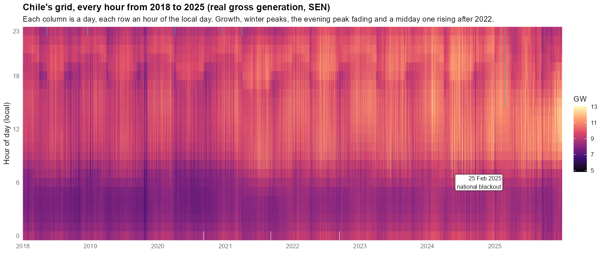
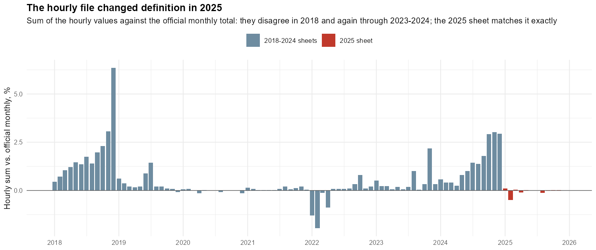
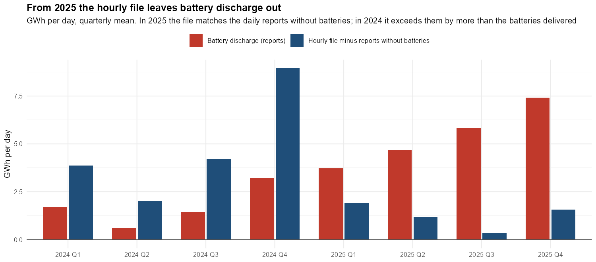
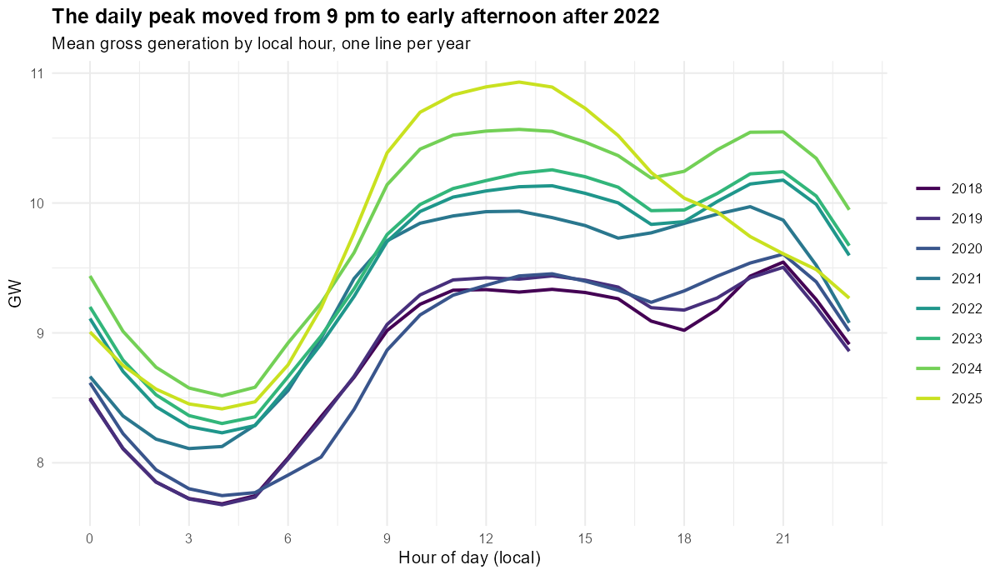
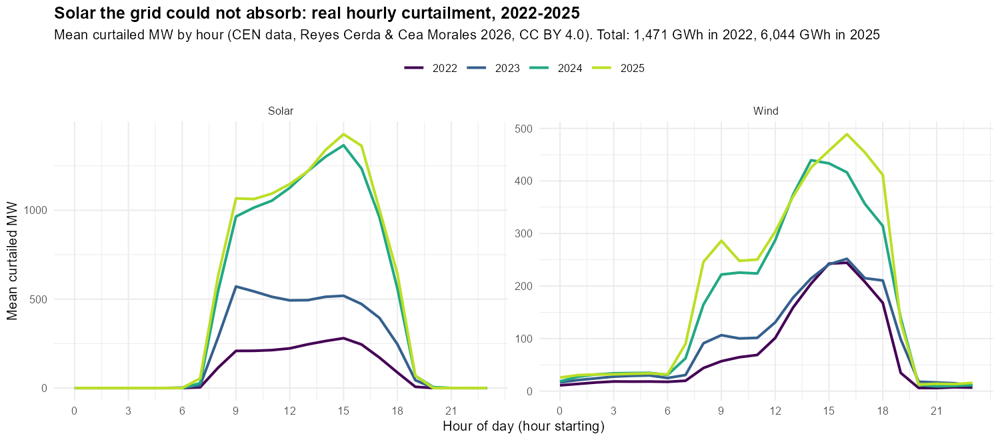
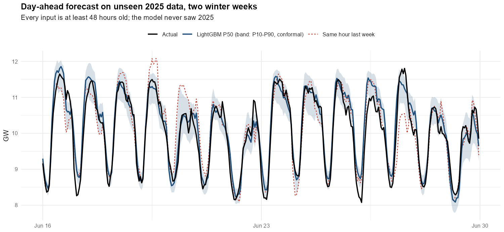
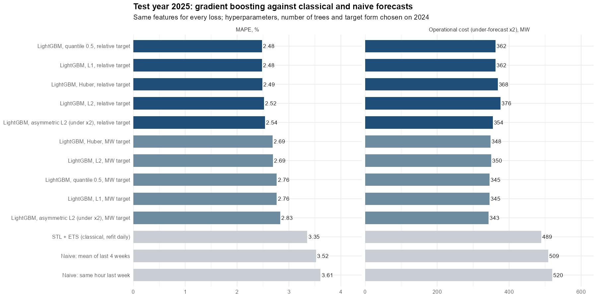
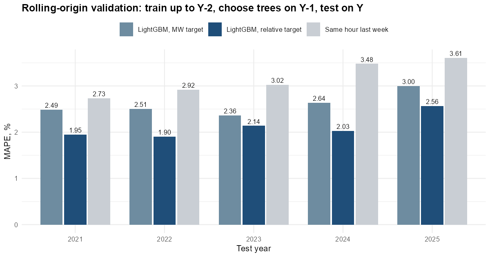
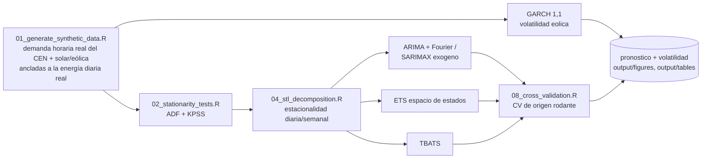

<div align="center">

# ⚡ Pronóstico Estadístico de Demanda Energética y Estabilidad de Red en el SEN Chile

**Un proyecto de extremo a extremo en R sobre la red chilena: pronóstico del día siguiente con machine learning (LightGBM, siete funciones de pérdida, intervalos conformales) sobre 70.128 horas reales del Coordinador, más ARIMA/SARIMAX, STL, ETS y GARCH sobre el ecosistema tidyverts/fable**

[[English](README.md) ] | [Español ]

[](https://www.r-project.org/)
[](https://fable.tidyverts.org/)
[](https://cran.r-project.org/package=forecast)
[](https://cran.r-project.org/package=rugarch)
[](R/11_ml_day_ahead.R)
[](R/10_real_hourly_data.R)
[](LICENSE)

</div>

---

## Datos horarios reales del SEN y pronóstico del día siguiente con machine learning (2018-2025)

La API del Coordinador pide una cuenta institucional, así que las versiones anteriores de este proyecto simulaban la forma hora a hora de la demanda y anclaban a datos reales solo su energía mensual. Ahora todas las secciones usan una fuente que no pide cuenta: el **archivo público de generación bruta horaria del Coordinador** (`CEN-hist_gen_de_energia_por_hora`, una hoja por año desde 2000). En un sistema aislado como el SEN, la generación bruta horaria es la demanda más las pérdidas, así que es la carga horaria real. `R/10_real_hourly_data.R` lee 2018-2025 (70.128 horas; el SEN existe como un solo sistema desde la interconexión de 2017) y le agrega la temperatura horaria de Santiago (Open-Meteo, ERA5) y los feriados nacionales.



*Cada columna es un día, cada fila una hora del día local. La red crece, las noches de invierno son la punta antigua, y desde 2023 la franja más clara se mueve al mediodía. Las marcas celestes son horas descartadas como anómalas.*

### Lo que el archivo necesitó antes de poder usarse

- **La hoja 2025 trae las horas de cada día en orden alfabético** (1, 10, 11, ..., 19, 2, 20, ...) aunque las rotula 1, 2, 3. El apagón nacional del 25 de febrero de 2025 lo delata: en el orden publicado hay una hora normal (9.800 MW) entre horas cercanas a cero. Puestas en su orden real, la caída parte a las 15:00, cuando ocurrió, y el perfil medio del año tiene su mínimo a las 4 a.m. como todos los demás años.
- **Días de cambio de horario.** El día de 23 horas viene con 24 filas, la primera es la hora que no existe, con valor 0; el día de 25 horas viene con 24 filas. Las filas se ubican por su orden desde el inicio real de cada día local, y la hora que falta queda como faltante.
- **Anomalías.** Se marcan las horas bajo la mitad de la mediana de esa misma hora en los 14 días alrededor: el apagón (15 horas entre el 25 y el 26 de febrero de 2025) y un cero suelto. Junto con las 12 horas que el archivo no trae, quedan fuera del entrenamiento y de toda métrica.
- **El archivo cambió de definición en 2025: dejó de contar la descarga de las baterías.** Sumadas por mes, las horas calzan exacto con la generación mensual oficial en 2025, pero la superan hasta en 3% durante 2023-2024 (y en 2018), y desde el 1 de enero de 2025 las horas de la noche bajan cerca de 1 GW y el mediodía no. Los informes diarios de operación del Coordinador, que listan la generación de cada día por tecnología incluidas las baterías (`R/13_cen_daily_reports.R`, 706 de 731 días), dicen qué cambió: en 2025 el archivo horario calza con el total de los informes *sin* baterías a menos de 1,3 GWh diarios (contra -4,2 GWh con ellas), mientras las baterías entregaron 5,4 GWh diarios, sobre todo en la noche. En 2024 el archivo supera incluso al total con baterías por unos 3 GWh diarios, lo que sigue sin explicación. El año de prueba mide algo levemente distinto de los años de entrenamiento.







### Más datos reales: vertimiento

Vertimiento horario solar y eólico (energía que la red no pudo absorber) por central, 2022-2026, del dataset de Reyes Cerda y Cea Morales construido desde los reportes mensuales de reducciones del Coordinador (Zenodo, CC BY 4.0), agregado a todo el sistema. El vertimiento pasó de 1.471 GWh en 2022 a 6.044 GWh en 2025, casi todo solar entre las 9 y las 18 horas: las mismas horas del mediodía en que la generación bruta tiene ahora su punta.



### Pronóstico del día siguiente con gradient boosting (`R/11_ml_day_ahead.R`)

- **Protocolo honesto de día siguiente.** Toda variable tiene al menos 48 horas de antigüedad (rezagos de 2 a 14 días, promedios móviles, misma hora en las últimas cuatro semanas), más calendario, feriados y temperatura. Con eso se pronostica todo el día D a la medianoche de D-1.
- **Particiones.** Entrenamiento 2018-2023 (50.378 horas), validación 2024 (8.614), prueba 2025 (8.378), sin tocar hasta el final. Los hiperparámetros salen de una búsqueda aleatoria de 16 configuraciones con early stopping sobre 2024; los modelos finales se reentrenan con 2018-2024 con el número de árboles elegido.
- **Dos formas del objetivo.** Un árbol no extrapola: entrenado en MW, sigue prediciendo el nivel de los años que vio. El **objetivo relativo** divide cada hora por el promedio de la última semana conocida, así el modelo aprende la forma y el nivel lo ponen los datos. Se elige con 2024, no con la prueba: MAPE 2,04% relativo contra 2,42% en MW.
- **Siete funciones de pérdida**, mismas variables e hiperparámetros: L2, L1, Huber, cuantílicas 0,1/0,5/0,9 y una L2 asimétrica escrita como objetivo propio, que pesa el doble quedarse corto que pasarse (subestimar la demanda obliga a activar reserva cara).



**Año de prueba 2025** (todos los modelos sobre las mismas 8.378 horas):

| Modelo | MAPE | RMSE (MW) | MASE | Sesgo (MW) | Costo, corto x2 (MW) |
|---|---:|---:|---:|---:|---:|
| Ingenuo: misma hora la semana pasada | 3,61% | 485 | 1,30 | +6 | 520 |
| STL + ETS, reajustado cada día (clásico) | 3,35% | 446 | 1,21 | -8 | 489 |
| LightGBM, L2, objetivo en MW | 2,69% | 353 | 0,96 | +75 | 350 |
| LightGBM, L2 asimétrica, objetivo en MW | 2,83% | 367 | 1,01 | +125 | **343** |
| LightGBM, L2, objetivo relativo | 2,52% | 336 | 0,92 | -16 | 376 |
| **LightGBM, L1, objetivo relativo** | **2,48%** | **331** | **0,90** | **-2** | 362 |
| LightGBM, L2 asimétrica, objetivo relativo | 2,54% | 337 | 0,92 | +28 | 354 |



- **El objetivo relativo gana y elimina el sesgo.** En MW los modelos sobreestiman 2025 en 75-125 MW, porque 2025 es el primer año en que la generación bajó y un árbol solo conoce los niveles que vio. Relativo al nivel de la semana anterior, el sesgo es casi cero y el MAPE baja de 2,69% a 2,48%: 31% bajo el ingenuo semanal y 26% bajo STL + ETS.
- **La pérdida cambia el error que se obtiene, no solo el número.** L1 y el cuantil mediano son los mejores pronósticos puntuales con objetivo relativo. La pérdida asimétrica cede un poco de MAPE para sobreestimar a propósito, y dentro de cada forma del objetivo tiene el menor costo que pesa doble quedarse corto. El modelo más barato en total es el asimétrico en MW, pero en parte por suerte: la caída de nivel de 2025 hizo sobreestimar a todos los modelos en MW, y ese costo lo premia.
- **Reentrenar con 2018-2024 importa.** El mismo modelo relativo entrenado solo hasta 2023 marca 2,56%; con 2024 incluido, 2,52%. En MW la diferencia es mayor (3,00% contra 2,69%).

**Validación de origen móvil** (entrenar hasta Y-2, elegir árboles en Y-1, probar en Y): el objetivo relativo le gana al objetivo en MW y al ingenuo todos los años.

| Año de prueba | 2021 | 2022 | 2023 | 2024 | 2025 |
|---|---:|---:|---:|---:|---:|
| LightGBM, objetivo relativo | 1,95% | 1,90% | 2,14% | 2,03% | 2,56% |
| LightGBM, objetivo en MW | 2,49% | 2,51% | 2,36% | 2,64% | 3,00% |
| Ingenuo: misma hora la semana pasada | 2,73% | 2,92% | 3,02% | 3,48% | 3,61% |



2025 es el año más difícil para todos los métodos, que es lo que predice el cambio de definición de arriba.

**Intervalos de predicción.** Los modelos cuantílicos prometen que el 80% de las horas cae entre P10 y P90. En 2025 los relativos cubren el 61,6% (17,9% bajo, 20,5% sobre). Calibrar la banda por regresión cuantílica conformal (CQR) con los residuos de 2024 la abre 64 MW por lado y sube la cobertura a 71,1%, con un ancho medio de 687 MW. Sigue bajo el 80% porque la garantía conformal supone que el año de calibración y el de prueba son intercambiables, y el cambio de definición del archivo rompe justamente eso.

**Qué mueve el pronóstico.** Por ganancia, el promedio de la misma hora en las últimas cuatro semanas (49%) y la misma hora una semana antes (23%) llevan la mayor parte, después la hora del día, dos semanas antes, el día de la semana, el día del año y el feriado.

## 1. Título del proyecto

**Pronóstico Estadístico de Demanda Energética y Estabilidad de Red en el Sistema Eléctrico Nacional (SEN) de Chile**

Repositorio: [`chile-energy-grid-forecasting-r`](https://github.com/Rxyxs/chile-energy-grid-forecasting-r)

## 2. Motivación

Me interesa este problema porque combina dos cosas que rara vez conviven en un solo dataset: series de tiempo con estacionalidad múltiple genuina (diaria, semanal, anual) y un componente de volatilidad real que importa operacionalmente, no solo estadísticamente. El Coordinador Eléctrico Nacional (CEN) es responsable de la coordinación en tiempo real y la planificación de largo plazo del SEN, que abastece a la gran mayoría de Chile continental. Dos tensiones estructurales hacen que el pronóstico riguroso importe ahí:

- **Creciente penetración solar y eólica.** Chile tiene una de las mayores irradiancias solares del mundo (Atacama) y un parque eólico en expansión, especialmente en el norte y el sur del país. Esa generación es intermitente por naturaleza: cae a cero en la noche (solar) y varía con el viento en rachas que se agrupan en el tiempo (clustering de volatilidad), no de forma independiente hora a hora.
- **El costo de una falla de red no es lineal.** Una rampa de demanda neta mal anticipada (el clásico problema de la "curva de pato": la demanda neta sube abruptamente cuando cae la generación solar al atardecer) obliga a activar reservas de generación rápida con poco preaviso, y en el peor caso deriva en desbalance de frecuencia.

Este proyecto construye el stack estadístico completo para abordar ambos problemas con las herramientas correctas para cada uno: modelos ARIMA/SARIMAX y de espacio de estados para el nivel esperado de demanda, y un modelo GARCH explícito para la volatilidad de la generación renovable -- no como un anexo cosmético, sino como la pieza que conecta el pronóstico de nivel con el riesgo real de estabilidad de red.

### 2.1 Impacto de Negocio e Indicadores Clave (KPIs)

| Métrica | Resultado | Qué significa |
|---|---|---|
| **Pronóstico del día siguiente con datos horarios reales, año de prueba 2025** | **MAPE 2,48%, MASE 0,90** | LightGBM con objetivo relativo, 31% bajo el ingenuo semanal (3,61%) y 26% bajo STL + ETS (3,35%); objetivo relativo elegido con 2024 |
| Modelos horarios clásicos sobre la demanda real (TBATS, ARIMA + Fourier) | 7,01% / 7,39% vs. 5,81% del ingenuo | Ambos pierden contra el ingenuo en el holdout de Navidad y se degradan en Fiestas Patrias; con la serie simulada anterior parecían 1,6x mejores (§7.1, §7.5) |
| Pronóstico de demanda neta con solar/eólica exógenas (SARIMAX) | RMSE 902 vs. 923 del ingenuo, MASE 0,87 vs. 0,81 | Una pequeña ventaja en RMSE y una pérdida en MASE; el MAPE se infla en las horas de mediodía cerca del piso de la demanda neta (§7.1) |
| Demanda diaria, validación cruzada de origen móvil (ETS vs. ingenuo) | MAPE 1,91% vs. 2,78% | El modelo clásico que sobrevive a los datos reales; también gana el holdout de 28 días (3,24% vs. 4,43%) |
| GARCH(1,1) sobre las rampas eólicas horarias | α₁ 0,363, β₁ 0,573, persistencia 0,936 | No es robusto: con la eólica anclada a la energía real mensual en vez de diaria da 0,010 / 0,989; solo la persistencia alta se mantiene (§7.2) |
| Autocorrelación residual en el lag 24, mejor corrección | 0,436 → 0,417 (Fourier K=12) | Una corrección pequeña; con datos reales parte de la autocorrelación a 24 horas probablemente es genuina (§7.3) |

### 2.2 Arquitectura del Pipeline



## 3. Marco teórico

### 3.1 ARIMA y SARIMAX

Un modelo ARIMA(p,d,q) combina autorregresión (AR), diferenciación (I, de "integrado") y promedio móvil (MA):

$$\left(1 - \sum_{i=1}^{p} \phi_i L^i\right)(1-L)^d y_t = \left(1 + \sum_{j=1}^{q} \theta_j L^j\right)\varepsilon_t$$

donde $L$ es el operador de rezago ($Ly_t = y_{t-1}$), $\phi_i$ son los coeficientes autorregresivos, $\theta_j$ los coeficientes de promedio móvil, y $\varepsilon_t$ es ruido blanco. SARIMAX extiende esto agregando regresores exógenos $X_t$:

$$y_t = \beta X_t + \left(1 - \sum \phi_i L^i\right)^{-1}\left(1 + \sum \theta_j L^j\right)(1-L)^{-d}\varepsilon_t$$

En este proyecto, en vez de un SARIMA estacional clásico con periodo 168 (inviable computacionalmente sobre ~17.500 observaciones horarias), la estacionalidad diaria y semanal se captura con **términos de Fourier** como regresores dentro de la parte ARIMA -- el enfoque estándar recomendado para series de alta frecuencia con estacionalidad múltiple (Hyndman & Athanasopoulos, *Forecasting: Principles and Practice*).

### 3.1.1 TBATS

TBATS (Trigonometric seasonality, Box-Cox transformation, ARMA errors, Trend, Seasonal components -- De Livera, Hyndman & Snyder, 2011) es una alternativa de espacio de estados a los términos de Fourier como regresores: cada componente estacional es un **estado que evoluciona en el tiempo**, no una sinusoide de amplitud fija, y el modelo estima conjuntamente su propia transformación Box-Cox y una corrección ARMA(p,q) sobre los errores:

$$y_t^{(\omega)} = \ell_{t-1} + \phi b_{t-1} + \sum_{i=1}^{T} s_{t-m_i}^{(i)} + d_t, \qquad d_t = \sum_{i=1}^{p}\varphi_i d_{t-i} + \sum_{j=1}^{q}\theta_j \varepsilon_{t-j} + \varepsilon_t$$

donde $y_t^{(\omega)}$ es la serie transformada por Box-Cox, $\ell_t$ el nivel, $b_t$ la tendencia amortiguada, y cada $s_t^{(i)}$ un estado estacional de periodo $m_i$ (acá $m_1=24$, $m_2=168$). §7.3 mide directamente por qué esto importa acá: los regresores de Fourier de amplitud fija de arriba dejan autocorrelación residual en el lag 24 que los estados dinámicos de TBATS reducen sustancialmente más.

### 3.2 Descomposición STL

STL (*Seasonal-Trend decomposition using Loess*) descompone la serie en tendencia, componente(s) estacional(es) y remanente:

$$y_t = T_t + S_t^{(24)} + S_t^{(168)} + R_t$$

usando regresión local (Loess) iterativa para estimar cada componente sin asumir una forma funcional fija -- a diferencia de un ajuste sinusoidal puro, STL permite que la forma estacional cambie lentamente en el tiempo.

### 3.3 Modelos de espacio de estados (ETS)

ETS (Error-Tendencia-Estacionalidad) es una familia de **modelos de espacio de estados innovadores** (*innovations state space models*), no un ARIMA con otro nombre: cada modelo se especifica por el tipo de Error, Tendencia y Estacionalidad (aditivo, multiplicativo, o ninguno). El caso general con estado $\mathbf{x}_t$ sigue:

$$y_t = w(\mathbf{x}_{t-1}) + r(\mathbf{x}_{t-1})\varepsilon_t \qquad \mathbf{x}_t = f(\mathbf{x}_{t-1}) + g(\mathbf{x}_{t-1})\varepsilon_t$$

y el nivel, tendencia y estacionalidad se actualizan cada período mediante ecuaciones de suavizamiento exponencial ponderado, en vez de estimarse una sola vez sobre toda la muestra.

### 3.4 GARCH para volatilidad

GARCH(1,1) modela la varianza condicional de una serie cuando ésta exhibe *clustering* de volatilidad -- períodos de calma y períodos agitados que se agrupan en el tiempo, típico de generación eólica (rachas de viento correlacionadas):

$$\varepsilon_t = \sigma_t z_t, \quad z_t \sim N(0,1) \qquad \sigma_t^2 = \omega + \alpha_1 \varepsilon_{t-1}^2 + \beta_1 \sigma_{t-1}^2$$

con $\omega > 0$, $\alpha_1, \beta_1 \geq 0$, y $\alpha_1 + \beta_1 < 1$ para que el proceso sea estacionario en varianza. $\alpha_1 + \beta_1$ cercano a 1 indica alta persistencia (shocks de volatilidad que tardan en disiparse).

## 4. Explicación

### 4.1 Flujo de datos

```
R/01_generate_synthetic_data.R   →  data/sen_hourly.csv (anclado a data/real/)
        (Polars-like con dplyr)      (demanda, solar, eólica, demanda neta)
              ↓
R/02_data_wrangling.R            →  data/hourly_tsibble.rds
        (tsibble + fill_gaps)        data/daily_tsibble.rds
              ↓
R/03_stationarity_tests.R        →  output/tables/stationarity_tests.csv
R/04_stl_decomposition.R         →  output/figures/stl_*.png
              ↓
R/05_models_arima_sarimax.R      →  output/models/{arima_fourier,sarimax,tbats}_fit.rds
R/06_models_ets_statespace.R     →  output/models/ets_fit.rds
R/07_models_garch_volatility.R   →  output/models/garch_wind_fit.rds
              ↓
R/08_cross_validation.R          →  output/tables/accuracy_*.csv (incl. rolling-origin CV, horaria + diaria)
R/09_generate_plots.R            →  output/figures/{forecast,residuals}_*.png
              ↓
reports/02_Residual_Autocorrelation_Fourier.Rmd  →  reports/02_..._Fourier.html
        (se renderiza por separado -- ver §6.1)
```

`run_pipeline.R` ejecuta los 9 scripts en orden, cada uno como un **subproceso `Rscript` independiente** (no vía `source()`) -- una decisión de diseño deliberada, no cosmética: cada script tiene un bloque `if (sys.nframe() == 0) { ... }` que solo se activa cuando el script corre como proceso de tope (`Rscript archivo.R`), y **no se dispara** si el archivo se cargara con `source()` desde otro script. La primera versión del orquestador usaba `source()` y fallaba silenciosamente (no generaba ningún archivo, sin lanzar error) -- exactamente el tipo de bug que solo aparece al ejecutar el pipeline completo de punta a punta, no al probar cada script por separado.

### 4.2 Manipulación con tidyverse/tsibble

Toda la manipulación usa `dplyr` + `tsibble`, la estructura de datos "tidy" para series de tiempo: cada fila es una observación, cada columna una variable, y el índice temporal (`datetime` o `date`) queda registrado como metadata de la tabla, no como una columna cualquiera. Esto permite que `fill_gaps()`, `stretch_tsibble()` (para CV) y las funciones de `feasts`/`fable` operen automáticamente sobre el grano temporal correcto sin que el analista tenga que gestionar índices manualmente.

### 4.3 Lógica de validación cruzada

`stretch_tsibble(.init, .step)` genera múltiples "orígenes" de pronóstico con ventana de entrenamiento creciente (*rolling-origin cross-validation*, el estándar en series de tiempo -- a diferencia de k-fold, nunca se entrena con datos futuros al punto de pronóstico). Ver §7 para un hallazgo concreto de por qué esto importa más que un solo split train/test.

## 5. Metodología

### 5.1 Pruebas de estacionariedad (ADF, KPSS)

ADF (H0: raíz unitaria / no estacionaria) y KPSS (H0: estacionaria) se corren juntas porque tienen hipótesis nulas opuestas -- resultado real de este proyecto sobre la demanda horaria real:

| Serie | ADF (estad., p) | Conclusión ADF | KPSS (estad., p) | Conclusión KPSS |
|---|---|---|---|---|
| Demanda horaria (nivel) | -17,09, 0,01 | Estacionaria | 1,73, 0,01 | **No estacionaria** |
| Demanda horaria (1ra dif.) | -27,76, 0,01 | Estacionaria | 0,001, 0,10 | Estacionaria |
| Demanda neta horaria (nivel) | -13,92, 0,01 | Estacionaria | 8,56, 0,01 | **No estacionaria** |
| Demanda diaria promedio (nivel) | -4,69, 0,01 | Estacionaria | 0,70, 0,014 | **No estacionaria** |
| Demanda diaria promedio (1ra dif.) | -11,45, 0,01 | Estacionaria | 0,10, 0,10 | Estacionaria |

**ADF y KPSS no coinciden en el nivel de ninguna serie** -- la señal de libro de estacionariedad en tendencia (estacionaria alrededor de un patrón estacional determinista, no en media pura). Diferenciar una vez lo resuelve. Con la serie semisintética la demanda diaria promedio quedaba en el límite de la estacionariedad (KPSS p = 0,059); la demanda real no, porque su nivel se mueve con los feriados, el ciclo verano/invierno y el cambio de definición del archivo en 2025.

### 5.2 Detección de estacionalidad múltiple

La descomposición STL (`season(period = "day") + season(period = "week")`) sobre la demanda horaria entrega la siguiente varianza por componente:

| Componente | Varianza | Serie semisintética |
|---|---|---|
| Estacionalidad diaria | 808.231 | 3.702.111 |
| Estacionalidad semanal | 180.056 | 397.113 |
| Tendencia | 83.061 | 71.510 |
| Resto | 87.292 | 40.463 |

La estacionalidad diaria sigue dominando, pero por un margen mucho menor: el simulador dibujaba una doble punta fuerte de mañana y noche, mientras la demanda real tiene un día más plano con una sola punta al mediodía. El resto es ahora mayor que la tendencia y el doble de lo que producía el simulador: los feriados, la recuperación del apagón y el clima que ningún componente estacional captura.

### 5.3 Criterios de información (AIC, BIC)

| Modelo | AIC | AICc | BIC |
|---|---|---|---|
| ARIMA + Fourier (demanda), errores ARIMA(2,1,4) | 226.564 | 226.564 | 226.827 |
| SARIMAX (demanda neta, con solar/eólica exógenas), errores ARIMA(2,1,4) | 229.425 | 229.425 | 229.704 |
| ETS(M,Ad,M) (demanda diaria) | 12.377,3 | 12.377,8 | 12.436,5 |

Con la serie semisintética ETS elegía error y estacionalidad aditivos sin tendencia, ETS(A,N,A). Con la demanda real elige error y estacionalidad multiplicativos con tendencia amortiguada ($\phi = 0,977$) y un suavizado alto del nivel ($\alpha = 0,69$): el nivel se actualiza sobre todo con los últimos días, y así absorbe las caídas de los feriados que los modelos horarios arrastran durante toda la ventana de pronóstico. Los AIC solo son comparables dentro de una misma serie, no entre estas tres filas.

### 5.4 Métricas de error (MAPE, RMSE, MASE)

$$\text{MAPE} = \frac{100}{n}\sum \left|\frac{y_t - \hat{y}_t}{y_t}\right| \qquad \text{RMSE} = \sqrt{\frac{1}{n}\sum (y_t - \hat{y}_t)^2} \qquad \text{MASE} = \frac{\frac{1}{n}\sum |y_t - \hat{y}_t|}{\frac{1}{n-1}\sum |y_i - y_{i-1}|_{\text{train}}}$$

MASE > 1 significa "peor que un naive ingenuo sobre el propio set de entrenamiento"; MASE < 1 significa "mejor que ese naive" -- una escala comparable entre series de distinta magnitud, a diferencia de RMSE.

## 6. Desarrollo (código en R)

Pipeline modular en `R/`, sobre `tidyverse` + `tsibble` + `fable` + `feasts` + `rugarch`. Algunos fragmentos representativos (código real de este repositorio, no ilustrativo):

**Simulación explícita de un proceso GARCH(1,1) para el componente eólico en modo simulador** (`R/01_generate_synthetic_data.R`, `real = FALSE`) -- en el modo por defecto, anclado a datos reales, la eólica sale en cambio de la velocidad de viento real ERA5 (§7.2):

```r
simulate_garch11 <- function(n, omega, alpha, beta, seed) {
  set.seed(seed)
  sigma2 <- numeric(n); eps <- numeric(n)
  sigma2[1] <- omega / (1 - alpha - beta)
  eps[1] <- sqrt(sigma2[1]) * rnorm(1)
  for (t in 2:n) {
    sigma2[t] <- omega + alpha * eps[t - 1]^2 + beta * sigma2[t - 1]
    eps[t] <- sqrt(sigma2[t]) * rnorm(1)
  }
  list(eps = eps, sigma = sqrt(sigma2))
}
```

**ARIMA con términos de Fourier** (`R/05_models_arima_sarimax.R`) -- `d = 1` fijo, informado por §5.1 (ver las notas metodológicas sobre dos limitaciones reales de `fable` encontradas en este proyecto, más abajo). `K = 12` en el término diario es la base de Fourier completa para un ciclo de periodo 24 (límite de Nyquist) -- subido desde `K = 4` específicamente para atacar la autocorrelación residual del lag 24 de §7.3:

```r
fit_arima_fourier <- function(train_ts) {
  train_ts %>%
    model(
      arima_fourier = ARIMA(demand_mw ~ pdq(d = 1) +
                               fourier(period = "day", K = 12) +
                               fourier(period = "week", K = 2) + PDQ(0, 0, 0)),
      snaive_day = SNAIVE(demand_mw ~ lag("day"))
    )
}
```

**SARIMAX con generación renovable como regresor exógeno** (`R/05_models_arima_sarimax.R`) -- en operación real, el pronóstico solar/eólico viene de un modelo meteorológico independiente y se trata como insumo exógeno conocido al pronosticar la demanda neta:

```r
fit_sarimax_net_demand <- function(train_ts) {
  train_ts %>%
    model(
      sarimax = ARIMA(net_demand_mw ~ pdq(d = 1) + solar_mw + wind_mw +
                         fourier(period = "day", K = 12) +
                         fourier(period = "week", K = 2) + PDQ(0, 0, 0)),
      snaive_net = SNAIVE(net_demand_mw ~ lag("day"))
    )
}
```

**TBATS** (`R/05_models_arima_sarimax.R`) -- sin soporte de regresores exógenos (no hay analogo SARIMAX), ajustado solo sobre `demand_mw`, vía `msts`/`tbats` del paquete `forecast`:

```r
fit_tbats_demand <- function(train_ts) {
  demand_msts <- forecast::msts(train_ts$demand_mw, seasonal.periods = c(24, 168))
  forecast::tbats(demand_msts, use.parallel = FALSE)
}
```

**Validación cruzada de origen móvil, diaria** (`R/08_cross_validation.R`):

```r
run_daily_rolling_cv <- function(daily_ts, init_size = 550, step = 14, horizon = 7) {
  daily_ts %>%
    stretch_tsibble(.init = init_size, .step = step) %>%
    model(ets = ETS(demand_mw_mean), snaive_week = SNAIVE(demand_mw_mean ~ lag("week"))) %>%
    forecast(h = horizon) %>%
    fabletools::accuracy(daily_ts)
}
```

**Validación cruzada de origen móvil, horaria** (`R/08_cross_validation.R`, nuevo) -- una ventana de entrenamiento de tamaño **fijo** (no la expansiva de `stretch_tsibble`), para que todos los orígenes se comparen con la misma cantidad de historia, y un número acotado de orígenes para que reajustar una búsqueda ARIMA+Fourier completa en cada origen tome minutos, no horas:

```r
run_hourly_rolling_cv <- function(hourly_ts, init_size = 12000, step = 1000, horizon = 48, n_origins = 5) {
  # desliza una ventana fija de 12.000 horas de entrenamiento, avanzando `step`
  # horas por origen, reajusta ARIMA + Fourier (K=12) cada vez, pronostica 48h -- ver §7.5
}
```

> **Nota metodológica -- bug real encontrado y su solución:** la búsqueda automática del orden de diferenciación `d` de `fable::ARIMA()` (v0.5.0) falla de forma silenciosa (error interno sin mensaje) sobre esta serie, tanto en R 4.4.0 como en R 4.6.1 -- se aisló probando `stats::arima()` base (funciona sin problema), luego una grilla de complejidad creciente hasta encontrar que fijar `p,q` y dejar `d` en búsqueda automática falla, pero fijar `d` (o cualquier orden completo) y dejar `p,q` en búsqueda automática funciona correctamente. La solución no es solo un workaround: como `d=1` ya estaba justificado empíricamente por ADF/KPSS (§5.1), fijarlo explícitamente es *más* defendible metodológicamente que confiar en una búsqueda automática de caja negra.

> **Nota metodológica 2 -- la misma clase de bug, encontrada de nuevo:** persiguiendo la corrección del lag 24 de §7.3, un término estacional explícito en periodo 24 (`PDQ(P=1,D=0,Q=1,period=24)`, y por separado `D=1` de diferenciación estacional en periodo 24) fallaron ambos con *"No se encontró un modelo ARIMA apropiado... raíces características que pueden ser numéricamente inestables"* -- la misma firma de falla que el bug de búsqueda de `d` de arriba, ahora confirmada también en la búsqueda de orden estacional. Documentado como una limitación real y reproducible de `fable::ARIMA()` sobre esta serie, no un error de especificación de este proyecto; ver `reports/02_Residual_Autocorrelation_Fourier.Rmd` para el recorrido completo de lo que se probó.

### 6.1 Renderizando el reporte reproducible

```powershell
Rscript run_pipeline.R    # debe correr primero -- el reporte lee sus modelos/tablas guardados
Rscript -e "rmarkdown::render('reports/02_Residual_Autocorrelation_Fourier.Rmd')"
```

`reports/02_Residual_Autocorrelation_Fourier.Rmd` es un documento R Markdown completamente reproducible por sí mismo (no solo un script): reajusta el modelo baseline original (`K=4`) él mismo (así la comparación no es un número citado de una corrida pasada), explica por qué, con la demanda real, la autocorrelación residual ya no se puede contrastar con un proceso generador conocido (§7.3), y renderiza diagnósticos ACF/PACF para los tres modelos más la tabla de CV de origen móvil horaria. Requiere Pandoc (viene incluido con RStudio; `rmarkdown::pandoc_available()` lo chequea). La salida (`reports/*.html`) está en `.gitignore`, igual que cualquier otro artefacto generado en este repositorio -- renderizarlo es parte de reproducir el proyecto, no un entregable versionado.

## 7. Resultados

Cada número de esta sección es sobre la **demanda horaria real** del archivo del Coordinador (2024-2025), con la solar y la eólica reconstruidas desde clima real y ancladas a la energía diaria real de cada tecnología en los informes diarios del Coordinador (ver el Disclaimer de datos). Hasta esta ronda la forma hora a hora de la demanda era simulada y solo su energía mensual era real; donde una conclusión cambió, se muestra el número anterior junto al nuevo.

### 7.1 Comparación de precisión de modelos

**Holdout horario fijo (14 días, 18 al 31 de diciembre de 2025) -- demanda:**

| Modelo | MAPE | RMSE | MASE |
|---|---|---|---|
| **SNAIVE (misma hora, día anterior)** | **5,81%** | **765** | **1,32** |
| TBATS | 7,01% | 823 | 1,62 |
| ARIMA + Fourier (K=12) | 7,39% | 866 | 1,70 |

**Con la demanda real, los dos modelos estadísticos pierden contra el ingenuo.** Con la serie simulada le ganaban (TBATS 4,28%, ARIMA + Fourier 4,54%, ingenuo 6,73%). El holdout son las dos semanas de Navidad y Año Nuevo, cuando la demanda cae en feriados que ningún modelo conoce: el valor de ayer se adapta en un día, un modelo ajustado sobre dos años de semanas normales no. No es una ventana con mala suerte: la validación de origen móvil de §7.5 muestra lo mismo en Fiestas Patrias. El modelo de machine learning del comienzo de este README, que tiene el calendario de feriados como variable, marca 2,48% sobre todo 2025.

**Holdout horario fijo (14 días) -- demanda neta (SARIMAX, K=12):**

| Modelo | MAPE | RMSE | MASE |
|---|---|---|---|
| SARIMAX (solar + eólica exógenas) | 21,73% | **902** | 0,87 |
| SNAIVE | **16,36%** | 923 | **0,81** |

SARIMAX ahora le gana al ingenuo solo en RMSE y pierde en MASE; con la serie simulada ganaba en ambas (RMSE 800 contra 1.080). El MAPE sigue engañando en demanda neta: cerca del mediodía la solar lleva la demanda neta hacia su piso, y dividir por esos valores chicos infla cualquier error.

**Demanda media diaria -- holdout fijo de 28 días y validación cruzada de origen móvil (13 orígenes, horizonte de 7 días):**

| Modelo | MAPE holdout | RMSE holdout | MAPE CV | RMSE CV | MASE CV |
|---|---|---|---|---|---|
| **ETS(M,Ad,M)** | **3,24%** | **553** | **1,91%** | **281** | **0,66** |
| SNAIVE semanal | 4,43% | 624 | 2,78% | 385 | 0,96 |

ETS es el modelo clásico que sobrevive a los datos reales: le gana al ingenuo semanal en el holdout y en la validación cruzada, como con la serie simulada (donde la CV daba 0,77% contra 1,38%). Promediar por día elimina la mayor parte de los golpes de feriados y clima a nivel de hora que hunden a los modelos horarios.

### 7.2 GARCH sobre las rampas eólicas

Ninguna fuente pública entrega la generación eólica hora a hora, así que la eólica horaria se reconstruye desde clima real (viento a 100 m y una curva de potencia) y se ancla a la energía real. La estimación del GARCH depende de ese anclaje:

| Eólica anclada a | $\alpha_1$ | $\beta_1$ | Persistencia | Volatilidad a 1 hora |
|---|---|---|---|---|
| Energía mensual real (versión anterior) | 0,010 | 0,989 | 0,999 | 394 MW/h |
| **Energía diaria real (informes diarios del Coordinador)** | **0,363** | **0,573** | **0,936** | **668 MW/h** |

Con el anclaje diario, las rampas de un día de mucho viento se escalan a la energía real de ese día, así que los golpes son más grandes y se disipan más rápido. (Los factores diarios se interpolan hora a hora para que no creen saltos a medianoche: la rampa absoluta media a medianoche es 1,16 veces la del resto del día con ambos anclajes.) La persistencia alta se mantiene en ambos; la división entre $\alpha_1$ y $\beta_1$ no, y ninguna de las dos filas es una medición de la volatilidad real de la eólica horaria. La generación eólica horaria real, que el Coordinador publica solo para cuentas registradas, lo resolvería.

### 7.3 Diagnóstico de residuos -- la investigación del lag 24

Recalculado sobre la demanda real por `reports/02_Residual_Autocorrelation_Fourier.Rmd`:

| Modelo | ACF(lag 24) | p de Ljung-Box | Cambio vs. K=4 |
|---|---|---|---|
| ARIMA + Fourier (K=4, base) | 0,436 | 0 | -- |
| ARIMA + Fourier (K=12) | 0,417 | 0 | -4,4% |
| TBATS | 0,454 | 0 | +4,0% |

El pico es mayor que con la serie simulada (0,388) y la mejor corrección ayuda menos (-4,4% contra -10,6%); TBATS sigue sin ayudar. Lo que más cambió es lo que significa el pico. Con la serie simulada se podía restar el proceso generador conocido y comprobar que lo que quedaba era ruido blanco (`ACF(lag24) = 0,004`), lo que probaba que el pico era un artefacto del modelo. Con datos reales no hay proceso generador que restar, y parte de la autocorrelación a 24 horas probablemente es genuina: el clima, los feriados y las fallas persisten de un día al siguiente. Un pico en el lag 24 ya no prueba que el modelo esté mal especificado, y Ljung-Box rechaza ruido blanco en los tres modelos.


**Cómo leerlo**: los tres paneles son la serie de residuos, su ACF y su distribución. El pico en el lag 24 del panel del medio es lo que sobrevive después de llevar la base de Fourier diaria a su límite de Nyquist. Son residuos a un paso, así que aquí un feriado le cuesta al modelo solo unas horas; el costo aparece en los pronósticos de varios días (§7.1, §7.5). El residuo más grande por lejos, unos 4.250 MW, es el 26 de febrero de 2025, donde las horas imputadas del apagón se encuentran con la recuperación real. La ACF y la PACF de los residuos de TBATS están en `output/figures/tbats_residuals_acf.png` y `tbats_residuals_pacf.png`.

### 7.4 Gráficos generados


La tendencia se mueve entre unos 9.200 y 10.450 MW, más alta en invierno y a comienzos del verano. El panel del resto es donde los datos reales más difieren de la serie simulada: caídas bruscas en los feriados y la más profunda a fines de febrero de 2025, la recuperación después del apagón nacional (las horas del apagón mismo están imputadas, ver el disclaimer). La serie simulada no tenía ninguno de esos eventos, y eso explica buena parte de por qué los modelos estadísticos se veían mejor con ella.


Las dos últimas semanas de 2025: una sola punta al mediodía en vez de las puntas de mañana y noche que dibujaba el simulador, fines de semana más bajos y el día de Navidad muy por debajo del resto. La punta única al mediodía es verano, mucha solar y un archivo 2025 que ya no cuenta la descarga de baterías en la noche (ver el comienzo de este README).


Diez días de contexto y el pronóstico de catorce días: el modelo repite una forma semanal promedio y no puede anticipar las caídas de los feriados, que es de donde sale su error en §7.1.

Todos los gráficos están en `output/figures/`, generados por `R/04_stl_decomposition.R`, `R/09_generate_plots.R` y `R/12_real_figures.R`:

**Una nota para quien los regenere.** Los rótulos de las figuras están en inglés porque `README.md` es el documento que GitHub muestra por defecto y ambas versiones del README incrustan los mismos PNG. El eje de fechas necesitó algo más que traducir textos: `ggplot2` lo formatea con el locale de la máquina que genera, así que en una instalación `es-CL` salía `sept. 21`. Los scripts de gráficos fijan `Sys.setlocale("LC_TIME", "C")`, la misma clase de fuga que el formato invariante previene en el I/O de archivos.

- `stl_decomposition.png` -- descomposición tendencia + estacional diaria + estacional semanal + resto
- `demand_two_week_zoom.png` -- detalle de 2 semanas de la demanda horaria real
- `stl_acf_demand.png`, `stl_acf_remainder.png`, `stl_pacf_demand.png` -- ACF/PACF
- `forecast_arima_demand.png`, `forecast_ets_daily.png` -- pronósticos con bandas de incertidumbre 80%/95%
- `residuals_arima.png`, `residuals_ets.png` -- diagnóstico de residuos
- `garch_wind_volatility_forecast.png` -- pronóstico de volatilidad condicional a 48 horas
- `tbats_residuals_acf.png`, `tbats_residuals_pacf.png` -- generados por `reports/02_Residual_Autocorrelation_Fourier.Rmd`, no por el pipeline numerado (§6.1)
- `real_*.png`, `ml_*.png` -- la sección de datos reales y machine learning del comienzo

### 7.5 Validación cruzada de origen móvil horaria

`run_hourly_rolling_cv()` (`R/08_cross_validation.R`): una ventana de entrenamiento fija de 12.000 horas (~500 días) desplazada por 5 orígenes (pasos de 1.000 horas), reajustando ARIMA + Fourier (K=12) cada vez y pronosticando 48 horas:

| Origen | Ventana pronosticada (2025) | MAPE | RMSE | MASE | Tiempo de ajuste |
|---|---|---|---|---|---|
| 1 | 14-16 de mayo | 3,24% | 429 | 0,73 | 80 s |
| 2 | 25-27 de junio | 3,92% | 450 | 0,87 | 47 s |
| 3 | 6-8 de agosto | 5,93% | 634 | 1,24 | 87 s |
| 4 | **16-18 de septiembre** | **8,57%** | **910** | **1,73** | 84 s |
| 5 | 28-30 de octubre | 4,50% | 513 | 1,04 | 50 s |

MAPE medio de 5,23% (4,28% con la serie simulada). La peor ventana es la que contiene Fiestas Patrias (18 y 19 de septiembre), el feriado más grande de Chile: la misma falla del holdout de Navidad de §7.1, en otra época del año. Las semanas normales se pronostican con 3-4%; los feriados no, porque nada en el modelo le dice que un día es feriado.

## 8. Conclusión

Llevar los modelos estadísticos a la demanda horaria real cambió el resultado principal, y se reporta tal como salió:

- **ARIMA + Fourier y TBATS horarios ya no le ganan al ingenuo** en el holdout cargado de feriados, y su validación móvil se degrada justo en Fiestas Patrias. Con la serie simulada, que no tenía feriados, fallas ni apagones, parecían 1,6 veces mejores que el ingenuo.
- **ETS sobre la demanda diaria sigue ganando**, en el holdout y en la validación cruzada.
- **SARIMAX sobre la demanda neta** mantiene una pequeña ventaja en RMSE y pierde en MASE.
- **El resultado del GARCH no es robusto** a cómo se reconstruye la eólica horaria; solo la persistencia alta sobrevive a ambas versiones.
- **El modelo que funciona a nivel horario es el que tiene calendario**: el pronóstico LightGBM del día siguiente del comienzo de este README (MAPE 2,48% en 2025).

**Valor para los operadores del SEN:** un pronóstico ETS diario como base, un modelo horario que conozca el calendario de feriados para la forma del día siguiente, y una estimación de la volatilidad de las rampas eólicas tratada como indicativa hasta tener eólica horaria real.

**Limitaciones y trabajo futuro:**
- Variables de feriado para ARIMA, SARIMAX y TBATS son el siguiente paso obvio; la evidencia de arriba dice que de ahí sale el error horario.
- La solar y la eólica se reconstruyen hora a hora desde el clima; solo su energía diaria (y mensual) es real. La demanda neta hereda eso.
- El backtest de SARIMAX usa los valores reales de solar/eólica del período de holdout, no un pronóstico de ellos.
- El archivo horario cambió de definición en 2025 (dejó fuera la descarga de baterías); la ventana de entrenamiento 2024-2025 cruza ese cambio.

## Apéndice: instalación y uso

Requiere R 4.4+ (probado en 4.4.0 y 4.6.1).

```powershell
git clone https://github.com/Rxyxs/chile-energy-grid-forecasting-r.git
cd chile-energy-grid-forecasting-r
Rscript R/00_setup.R      # instala tidyverse, tsibble, fable, feasts, forecast, rugarch, tseries, ggtime, rmarkdown
Rscript run_pipeline.R    # corre los 9 pasos de punta a punta (TBATS + CV horaria suman ~15-20 min)

# Datos horarios reales y machine learning (sección del comienzo)
Rscript R/10_real_hourly_data.R   # descarga el archivo del CEN, escribe data/real/sen_hourly_real.csv.gz
Rscript R/11_ml_day_ahead.R       # ~25 min en la CPU de un notebook
Rscript R/12_real_figures.R
Rscript -e "rmarkdown::render('reports/02_Residual_Autocorrelation_Fourier.Rmd')"  # opcional, §6.1
```

### Ejecutando los tests

`tests/testthat/` cubre el lector de los datos reales (hoja 2025 en orden alfabético, días de cambio de horario, marcas de anomalía), el lector de los informes diarios (ambos formatos numéricos, eje del gráfico y filas en MWh ignorados, columnas pegadas por el PDF), las funciones de machine learning (rezagos de 48 horas, objetivo relativo, gradiente asimétrico, pérdida pinball, margen conformal) y las funciones puras de generación y transformación de datos (`R/01_generate_synthetic_data.R`, `R/02_data_wrangling.R`) que no requieren un modelo ajustado: estacionariedad/reproducibilidad de la simulación GARCH(1,1), el perfil horario de doble punta, invariantes del simulador (demanda neta, generación no negativa, solar nula de noche), que la energía mensual del modo real coincida con las cifras reales del SEN, el modo de demanda real del CEN (apagón imputado y marcado), y la agregación de tsibbles horario/diario (relleno de gaps, agrupación y totales correctos).

```powershell
Rscript -e "install.packages('testthat', repos='https://cloud.r-project.org')"  # una vez
Rscript tests/testthat.R
```

### Estructura del repositorio

```
chile-energy-grid-forecasting-r/
├── R/
│   ├── 00_setup.R                      # instalación de paquetes
│   ├── 01_generate_synthetic_data.R    # serie del SEN anclada a datos reales (simulador como real = FALSE)
│   ├── 02_data_wrangling.R             # tsibble horario + diario
│   ├── 03_stationarity_tests.R         # ADF, KPSS
│   ├── 04_stl_decomposition.R          # STL multi-estacional + gráficos
│   ├── 05_models_arima_sarimax.R       # ARIMA + Fourier (K=12), SARIMAX, TBATS
│   ├── 06_models_ets_statespace.R      # ETS (espacio de estados)
│   ├── 07_models_garch_volatility.R    # GARCH(1,1) sobre volatilidad eólica
│   ├── 08_cross_validation.R           # holdout + rolling-origin CV (horaria + diaria), MAPE/RMSE/MASE
│   ├── 09_generate_plots.R             # residuos, pronósticos con bandas, volatilidad
│   ├── 10_real_hourly_data.R           # generación horaria real del CEN 2018-2025: lectura, cambio de horario, anomalías
│   ├── 11_ml_day_ahead.R               # LightGBM día siguiente: 7 pérdidas, 2 formas del objetivo, CQR, validación por años
│   ├── 12_real_figures.R               # figuras de la sección de datos reales
│   └── 13_cen_daily_reports.R          # generación diaria por tecnología de los informes del CEN + vertimiento
├── reports/
│   └── 02_Residual_Autocorrelation_Fourier.Rmd  # diagnóstico del lag 24, ACF/PACF, escrito honesto (§6.1, §7.3)
├── tests/
│   ├── testthat.R                      # runner de tests (Rscript tests/testthat.R)
│   └── testthat/                       # tests unitarios de generación + transformación de datos
├── run_pipeline.R                      # orquestador (subprocesos Rscript)
├── data/                               # CSVs + tsibbles .rds (generado, en .gitignore)
├── output/
│   ├── models/                         # modelos ajustados .rds, incl. tbats_fit.rds (generado)
│   ├── tables/                         # tablas de resultados .csv, incl. accuracy_rolling_cv_hourly.csv (generado)
│   └── figures/                        # gráficos .png (generado)
├── .gitignore
├── LICENSE
├── README.md
└── README.es.md
```

### Disclaimer de datos

**Qué es real.** La demanda horaria del SEN: la generación bruta del archivo horario público del Coordinador (2018-2025, serie procesada `data/real/sen_hourly_real.csv.gz`). La generación diaria por tecnología (solar, eólica, hidráulica, térmica, geotérmica, baterías) de los informes diarios de operación del Coordinador, 706 de los 731 días de 2024-2025 (`R/13_cen_daily_reports.R`, `data/real/cen_daily_by_technology.csv`). La generación mensual del SEN por tecnología (datos.gob.cl, CNE). El clima horario en cinco subestaciones y la temperatura de Santiago (Open-Meteo, ERA5), los feriados de Chile (Nager.Date), y el vertimiento horario solar y eólico 2022-2026 agregado desde el dataset por central de Reyes Cerda y Cea Morales (Zenodo, doi:10.5281/zenodo.21198817, CC BY 4.0; `data/real/curtailment_hourly_sen.csv.gz`).

**Qué está reconstruido o imputado.** La forma horaria de la solar y la eólica, desde clima real, anclada a la energía diaria real (mensual donde falta el informe del día); la demanda neta lo hereda. Las 15 horas del apagón del 25 y 26 de febrero de 2025 y las 12 horas que el archivo no trae se rellenan con la misma hora de la semana anterior para los modelos estadísticos (marcadas en `demand_imputed`) y quedan fuera de la sección de machine learning. El piso de 1.200 MW de generación mínima en la demanda neta es ilustrativo. `generate_sen_data(..., real = FALSE)` sigue produciendo la serie original completamente simulada, y `demand_source = "simulated"` la semisintética anterior.

## Autor

**Pablo Reyes** -- Científico de Datos, Universidad Mayor -- [github.com/Rxyxs](https://github.com/Rxyxs)
