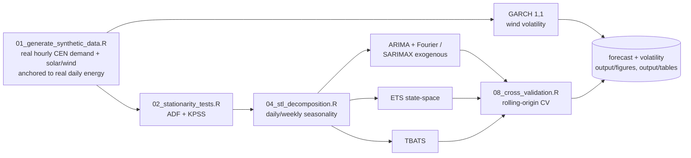

<div align="center">

# ⚡ Statistical Forecasting of Energy Demand and Grid Stability in Chile's SEN

**An end-to-end R project on Chile's grid: day-ahead machine learning (LightGBM, seven loss functions, conformal intervals) on 70,128 real hours from the Coordinador, plus ARIMA/SARIMAX, STL, ETS and GARCH on the tidyverts/fable ecosystem**

[English ] | [[Español](README.es.md) ]

[](https://www.r-project.org/)
[](https://fable.tidyverts.org/)
[](https://cran.r-project.org/package=forecast)
[](https://cran.r-project.org/package=rugarch)
[](R/11_ml_day_ahead.R)
[](R/10_real_hourly_data.R)
[](LICENSE)

</div>

---

## Real hourly SEN data and day-ahead machine learning (2018-2025)

The Coordinador's API needs an institutional account, so earlier versions of this project simulated the hour-to-hour shape of demand and anchored only its monthly energy to real data. Every section now uses a source that needs no account: the **Coordinador's public file of hourly gross generation** (`CEN-hist_gen_de_energia_por_hora`, one sheet per year since 2000). In an islanded system like the SEN, hourly gross generation is demand plus losses, so it is the real hourly load. `R/10_real_hourly_data.R` reads 2018-2025 (70,128 hours, the SEN exists as one system since the 2017 interconnection) and adds Santiago's hourly temperature (Open-Meteo, ERA5) and Chile's public holidays.


*Each column is a day, each row an hour of the local day. The grid grows, winter evenings are the old peak, and from 2023 the brightest band moves to midday. The light-blue marks are hours removed as anomalous.*

### What the file needed before it could be used

- **The 2025 sheet lists each day's hours in alphabetical order** (1, 10, 11, ..., 19, 2, 20, ...) while labelling them 1, 2, 3. The national blackout of 25 February 2025 gives it away: in the published order a normal hour (9,800 MW) sits between hours near zero. Put back in true order, the collapse starts at 15:00, when it happened, and the year's mean profile has its minimum at 4 am like every other year.
- **Daylight-saving days.** The 23-hour day is published with 24 rows, the first being the non-existent hour with value 0; the 25-hour day comes with 24 rows. Rows are placed by their order from the real start of each local day, and the missing hour is left missing.
- **Anomalies.** Hours below half the median of the same hour over the surrounding 14 days are flagged: the blackout (15 hours on 25-26 February 2025) and one stray zero. With the 12 hours the file does not have, they are excluded from training and from every metric.
- **The file changed definition in 2025: it stopped counting battery discharge.** Summed by month, the hourly values match the official monthly generation exactly in 2025, but exceed it by up to 3% through 2023-2024 (and in 2018), and from 1 January 2025 the evening hours drop by about 1 GW while midday does not. The Coordinador's daily operation reports, which list each day's generation by technology including batteries (`R/13_cen_daily_reports.R`, 706 of 731 days), say what changed: in 2025 the hourly file matches the reports' total *without* batteries to within 1.3 GWh a day (against -4.2 GWh with them), while the batteries delivered 5.4 GWh a day, mostly in the evening. In 2024 the file exceeds even the total with batteries by about 3 GWh a day, which remains unexplained. The test year therefore measures something slightly different from the training years.


### More real data: curtailment

Hourly solar and wind curtailment (energy the grid could not absorb) by plant, 2022-2026, from the dataset of Reyes Cerda and Cea Morales built from the Coordinador's monthly curtailment reports (Zenodo, CC BY 4.0), aggregated to the whole system. Curtailment went from 1,471 GWh in 2022 to 6,044 GWh in 2025, almost all of it solar between 9 am and 6 pm: the same midday hours where gross generation now peaks.


### Day-ahead forecast with gradient boosting (`R/11_ml_day_ahead.R`)

- **Honest day-ahead protocol.** Every input is at least 48 hours old (lags of 2 to 14 days, rolling means, same hour over the last four weeks), plus calendar, holidays and temperature. That is enough to forecast all of day D at midnight of D-1.
- **Splits.** Train 2018-2023 (50,378 hours), validate 2024 (8,614), test 2025 (8,378), never touched until the end. Hyperparameters come from a 16-configuration random search with early stopping on 2024; the final models are refit on 2018-2024 with the chosen number of trees.
- **Two target forms.** A tree cannot extrapolate: trained on MW it keeps predicting the level of the years it saw. The **relative target** divides each hour by the mean of the last known week, so the model learns the shape and the level comes from the data. Chosen on 2024, not on the test: MAPE 2.04% relative against 2.42% in MW.
- **Seven losses**, same features and hyperparameters: L2, L1, Huber, quantile 0.1/0.5/0.9 and an asymmetric L2 written as a custom objective, which weighs an under-forecast twice an over-forecast (under-forecasting demand calls expensive reserves).


**Test year 2025** (all models on the same 8,378 hours):

| Model | MAPE | RMSE (MW) | MASE | Bias (MW) | Cost, under x2 (MW) |
|---|---:|---:|---:|---:|---:|
| Naive: same hour last week | 3.61% | 485 | 1.30 | +6 | 520 |
| STL + ETS, refit every day (classical) | 3.35% | 446 | 1.21 | -8 | 489 |
| LightGBM, L2, MW target | 2.69% | 353 | 0.96 | +75 | 350 |
| LightGBM, asymmetric L2, MW target | 2.83% | 367 | 1.01 | +125 | **343** |
| LightGBM, L2, relative target | 2.52% | 336 | 0.92 | -16 | 376 |
| **LightGBM, L1, relative target** | **2.48%** | **331** | **0.90** | **-2** | 362 |
| LightGBM, asymmetric L2, relative target | 2.54% | 337 | 0.92 | +28 | 354 |


- **The relative target wins and removes the bias.** In MW the models over-forecast 2025 by 75-125 MW, because 2025 is the first year in which generation fell and a tree only knows the levels it saw. Relative to last week's level the bias is about zero and MAPE drops from 2.69% to 2.48%: 31% below the weekly naive forecast and 26% below STL + ETS.
- **The loss changes the error you get, not just the number.** L1 and the median quantile are the best point forecasts on the relative target. The asymmetric loss gives up a little MAPE to over-forecast on purpose, and within each target form it has the lowest under-forecast-weighted cost. The cheapest model overall is the asymmetric one in MW, but partly by luck: the 2025 level drop made every MW model over-forecast, which that cost rewards.
- **Refitting on 2018-2024 matters.** The same relative model trained only up to 2023 scores 2.56%; with 2024 included, 2.52%. In MW the gap is larger (3.00% against 2.69%).

**Rolling-origin validation** (train up to Y-2, choose trees on Y-1, test on Y): the relative target beats the MW target and the naive forecast every year.

| Test year | 2021 | 2022 | 2023 | 2024 | 2025 |
|---|---:|---:|---:|---:|---:|
| LightGBM, relative target | 1.95% | 1.90% | 2.14% | 2.03% | 2.56% |
| LightGBM, MW target | 2.49% | 2.51% | 2.36% | 2.64% | 3.00% |
| Naive: same hour last week | 2.73% | 2.92% | 3.02% | 3.48% | 3.61% |


2025 is the hardest year for every method, which is what the definition change above predicts.

**Prediction intervals.** The quantile models promise that 80% of hours fall between P10 and P90. On 2025 the relative ones cover 61.6% (17.9% below, 20.5% above). Calibrating the band by conformal quantile regression (CQR) on 2024 residuals widens it by 64 MW per side and raises coverage to 71.1%, with a mean width of 687 MW. It still falls short of 80% because conformal guarantees assume the calibration year and the test year are exchangeable, and the file's change of definition breaks exactly that.

**What drives the forecast.** By gain, the mean of the same hour over the last four weeks (49%) and the same hour a week earlier (23%) carry most of it, then the hour of day, two weeks earlier, weekday, day of year and the holiday flag.

## 1. Project title

**Statistical Forecasting of Energy Demand and Grid Stability in Chile's Sistema Eléctrico Nacional (SEN)**

Repository: [`chile-energy-grid-forecasting-r`](https://github.com/Rxyxs/chile-energy-grid-forecasting-r)

## 2. Motivation

I'm drawn to this problem because it combines two things that rarely coexist in a single dataset: genuine multi-seasonal time series (daily, weekly, annual) and a volatility component that matters operationally, not just statistically. Chile's Coordinador Eléctrico Nacional (CEN) is responsible for real-time coordination and long-term planning of the SEN, which supplies the large majority of continental Chile. Two structural tensions make rigorous forecasting matter there:

- **Growing solar and wind penetration.** Chile has some of the highest solar irradiance in the world (Atacama) and an expanding wind fleet, especially in the north and south. That generation is intermittent by nature: it drops to zero overnight (solar) and varies with wind gusts that cluster in time (volatility clustering), not independently hour to hour.
- **Grid failure cost isn't linear.** A poorly anticipated net-demand ramp (the classic "duck curve" problem: net demand spikes sharply as solar output falls off in the evening) forces fast-ramping reserves to activate on short notice, and in the worst case leads to frequency imbalance.

This project builds the full statistical stack to address both problems with the right tool for each: ARIMA/SARIMAX and state-space models for the expected level of demand, and an explicit GARCH model for renewable-generation volatility -- not as a cosmetic add-on, but as the piece that connects level forecasting to actual grid-stability risk.

### 2.1 Business Impact & Key Performance Indicators

| Metric | Result | What it means |
|---|---|---|
| **Day-ahead forecast on real hourly data, test year 2025** | **2.48% MAPE, MASE 0.90** | LightGBM on a relative target, 31% below the weekly naive forecast (3.61%) and 26% below STL + ETS (3.35%); relative target chosen on 2024 |
| Classical hourly models on real demand (TBATS, ARIMA + Fourier) | 7.01% / 7.39% vs. 5.81% naive | Both lose to the naive forecast on the Christmas holdout and degrade on Fiestas Patrias; on the old simulated series they looked 1.6x better (§7.1, §7.5) |
| Net-demand forecast with solar/wind exogenous (SARIMAX) | RMSE 902 vs. 923 naive, MASE 0.87 vs. 0.81 | A small RMSE edge, a MASE loss; MAPE is inflated by midday hours near the net-demand floor (§7.1) |
| Daily demand, rolling-origin CV (ETS vs. naive) | 1.91% vs. 2.78% MAPE | The classical model that survives real data; it also wins the 28-day holdout (3.24% vs. 4.43%) |
| GARCH(1,1) on hourly wind ramps | α₁ 0.363, β₁ 0.573, persistence 0.936 | Not robust: with wind anchored to monthly instead of daily real energy it gives 0.010 / 0.989; only high persistence holds (§7.2) |
| Residual lag-24 autocorrelation, best fix found | 0.436 → 0.417 (Fourier K=12) | A small fix; on real data part of the 24-hour autocorrelation is probably genuine (§7.3) |

### 2.2 Pipeline Architecture



## 3. Theoretical framework

### 3.1 ARIMA and SARIMAX

An ARIMA(p,d,q) model combines autoregression (AR), differencing (I, "integrated"), and moving average (MA):

$$\left(1 - \sum_{i=1}^{p} \phi_i L^i\right)(1-L)^d y_t = \left(1 + \sum_{j=1}^{q} \theta_j L^j\right)\varepsilon_t$$

where $L$ is the lag operator ($Ly_t = y_{t-1}$), $\phi_i$ are the autoregressive coefficients, $\theta_j$ the moving-average coefficients, and $\varepsilon_t$ is white noise. SARIMAX extends this by adding exogenous regressors $X_t$:

$$y_t = \beta X_t + \left(1 - \sum \phi_i L^i\right)^{-1}\left(1 + \sum \theta_j L^j\right)(1-L)^{-d}\varepsilon_t$$

Rather than a classic seasonal SARIMA with period 168 (computationally infeasible over ~17,500 hourly observations), this project captures daily and weekly seasonality via **Fourier terms** as regressors within the ARIMA component -- the standard recommended approach for high-frequency series with multiple seasonal periods (Hyndman & Athanasopoulos, *Forecasting: Principles and Practice*).

### 3.1.1 TBATS

TBATS (Trigonometric seasonality, Box-Cox transformation, ARMA errors, Trend, Seasonal components -- De Livera, Hyndman & Snyder, 2011) is a state-space alternative to regression-based Fourier terms: each seasonal component is a **state that evolves over time**, not a fixed-amplitude sinusoid, and the model jointly estimates its own Box-Cox transform and an ARMA(p,q) correction on the errors:

$$y_t^{(\omega)} = \ell_{t-1} + \phi b_{t-1} + \sum_{i=1}^{T} s_{t-m_i}^{(i)} + d_t, \qquad d_t = \sum_{i=1}^{p}\varphi_i d_{t-i} + \sum_{j=1}^{q}\theta_j \varepsilon_{t-j} + \varepsilon_t$$

where $y_t^{(\omega)}$ is the Box-Cox-transformed series, $\ell_t$ the level, $b_t$ the damped trend, and each $s_t^{(i)}$ a seasonal state at period $m_i$ (here $m_1=24$, $m_2=168$). §7.3 measures directly why this matters here: the fixed-amplitude Fourier regressors above leave residual autocorrelation at lag 24 that TBATS's dynamic states reduce substantially further.

### 3.2 STL decomposition

STL (*Seasonal-Trend decomposition using Loess*) decomposes the series into trend, seasonal component(s), and remainder:

$$y_t = T_t + S_t^{(24)} + S_t^{(168)} + R_t$$

using iterative local regression (Loess) to estimate each component without assuming a fixed functional form -- unlike a pure sinusoidal fit, STL lets the seasonal shape drift slowly over time.

### 3.3 State space models (ETS)

ETS (Error-Trend-Seasonal) is a family of **innovations state space models**, not an ARIMA in disguise: each model is specified by its Error, Trend, and Seasonal type (additive, multiplicative, or none). The general case with state $\mathbf{x}_t$ follows:

$$y_t = w(\mathbf{x}_{t-1}) + r(\mathbf{x}_{t-1})\varepsilon_t \qquad \mathbf{x}_t = f(\mathbf{x}_{t-1}) + g(\mathbf{x}_{t-1})\varepsilon_t$$

with level, trend, and seasonality updated every period via weighted exponential-smoothing equations, rather than estimated once over the whole sample.

### 3.4 GARCH for volatility

GARCH(1,1) models the conditional variance of a series that exhibits volatility clustering -- calm and turbulent periods that group together in time, typical of wind generation (correlated gusts):

$$\varepsilon_t = \sigma_t z_t, \quad z_t \sim N(0,1) \qquad \sigma_t^2 = \omega + \alpha_1 \varepsilon_{t-1}^2 + \beta_1 \sigma_{t-1}^2$$

with $\omega > 0$, $\alpha_1, \beta_1 \geq 0$, and $\alpha_1 + \beta_1 < 1$ for variance stationarity. $\alpha_1 + \beta_1$ close to 1 indicates high persistence (volatility shocks that take a long time to dissipate).

## 4. Explanation

### 4.1 Data flow

```
R/01_generate_synthetic_data.R   →  data/sen_hourly.csv (anchored to data/real/)
        (dplyr-based generator)      (demand, solar, wind, net demand)
              ↓
R/02_data_wrangling.R            →  data/hourly_tsibble.rds
        (tsibble + fill_gaps)        data/daily_tsibble.rds
              ↓
R/03_stationarity_tests.R        →  output/tables/stationarity_tests.csv
R/04_stl_decomposition.R         →  output/figures/stl_*.png
              ↓
R/05_models_arima_sarimax.R      →  output/models/{arima_fourier,sarimax,tbats}_fit.rds
R/06_models_ets_statespace.R     →  output/models/ets_fit.rds
R/07_models_garch_volatility.R   →  output/models/garch_wind_fit.rds
              ↓
R/08_cross_validation.R          →  output/tables/accuracy_*.csv (incl. rolling-origin CV, hourly + daily)
R/09_generate_plots.R            →  output/figures/{forecast,residuals}_*.png
              ↓
reports/02_Residual_Autocorrelation_Fourier.Rmd  →  reports/02_..._Fourier.html
        (rendered separately -- see §6.1)
```

`run_pipeline.R` runs all 9 scripts in order, each as an **independent `Rscript` subprocess** (not via `source()`) -- a deliberate design choice, not a cosmetic one: every script has an `if (sys.nframe() == 0) { ... }` guard that only triggers when the script runs as a top-level process (`Rscript file.R`), and does **not** fire if the file were loaded via `source()` from another script. The first version of the orchestrator used `source()` and failed silently -- it produced no output files and threw no error -- exactly the kind of bug that only surfaces when running the full pipeline end to end, not when testing each script individually.

### 4.2 tidyverse/tsibble data manipulation

All manipulation uses `dplyr` + `tsibble`, the tidy data structure for time series: each row is an observation, each column a variable, and the time index (`datetime` or `date`) is registered as table metadata, not just another column. This lets `fill_gaps()`, `stretch_tsibble()` (for CV), and `feasts`/`fable` functions operate automatically on the correct time grain without the analyst manually managing indices.

### 4.3 Cross-validation logic

`stretch_tsibble(.init, .step)` generates multiple forecast "origins" with an expanding training window (rolling-origin cross-validation, the time-series standard -- unlike k-fold, it never trains on data that lies in the future relative to the forecast point). See §7 for a concrete finding on why this matters more than a single train/test split.

## 5. Methodology

### 5.1 Stationarity tests (ADF, KPSS)

ADF (H0: unit root / non-stationary) and KPSS (H0: stationary) are run together because they have opposite null hypotheses -- actual result from this project on real hourly demand:

| Series | ADF (stat, p) | ADF conclusion | KPSS (stat, p) | KPSS conclusion |
|---|---|---|---|---|
| Hourly demand (level) | -17.09, 0.01 | Stationary | 1.73, 0.01 | **Non-stationary** |
| Hourly demand (1st diff.) | -27.76, 0.01 | Stationary | 0.001, 0.10 | Stationary |
| Hourly net demand (level) | -13.92, 0.01 | Stationary | 8.56, 0.01 | **Non-stationary** |
| Daily mean demand (level) | -4.69, 0.01 | Stationary | 0.70, 0.014 | **Non-stationary** |
| Daily mean demand (1st diff.) | -11.45, 0.01 | Stationary | 0.10, 0.10 | Stationary |

**ADF and KPSS disagree on the level of every series** -- the textbook sign of trend-stationarity (stationary around a deterministic seasonal pattern, not in pure mean). Differencing once resolves it. On the semi-synthetic series daily mean demand was borderline stationary (KPSS p = 0.059); real demand is not, because its level moves with holidays, the summer/winter cycle and the 2025 file definition change.

### 5.2 Multiple seasonality detection

STL decomposition (`season(period = "day") + season(period = "week")`) on hourly demand gives the following per-component variance:

| Component | Variance | Semi-synthetic series |
|---|---|---|
| Daily seasonality | 808,231 | 3,702,111 |
| Weekly seasonality | 180,056 | 397,113 |
| Trend | 83,061 | 71,510 |
| Remainder | 87,292 | 40,463 |

Daily seasonality still dominates, but by a much smaller margin: the simulator drew a strong morning and evening double peak, while real demand has a flatter day with one midday peak. The remainder is now larger than the trend and twice what the simulator produced -- the holidays, the blackout recovery and the weather that no seasonal component captures.

### 5.3 Information criteria (AIC, BIC)

| Model | AIC | AICc | BIC |
|---|---|---|---|
| ARIMA + Fourier (demand), errors ARIMA(2,1,4) | 226,564 | 226,564 | 226,827 |
| SARIMAX (net demand, with solar/wind exogenous), errors ARIMA(2,1,4) | 229,425 | 229,425 | 229,704 |
| ETS(M,Ad,M) (daily demand) | 12,377.3 | 12,377.8 | 12,436.5 |

On the semi-synthetic series ETS selected additive error and seasonality with no trend, ETS(A,N,A). On real demand it selects multiplicative error and seasonality with a damped trend ($\phi = 0.977$) and a high level smoothing ($\alpha = 0.69$): the level is updated mostly from the last few days, which is how it absorbs holiday dips that the hourly models carry for a whole forecast window. AIC values are only comparable within a series, not across these three rows.

### 5.4 Error metrics (MAPE, RMSE, MASE)

$$\text{MAPE} = \frac{100}{n}\sum \left|\frac{y_t - \hat{y}_t}{y_t}\right| \qquad \text{RMSE} = \sqrt{\frac{1}{n}\sum (y_t - \hat{y}_t)^2} \qquad \text{MASE} = \frac{\frac{1}{n}\sum |y_t - \hat{y}_t|}{\frac{1}{n-1}\sum |y_i - y_{i-1}|_{\text{train}}}$$

MASE > 1 means "worse than a naive forecast on the training set itself"; MASE < 1 means "better than that naive" -- a scale comparable across series of different magnitude, unlike RMSE.

## 6. Development (R code)

Modular pipeline under `R/`, built on `tidyverse` + `tsibble` + `fable` + `feasts` + `rugarch`. A few representative excerpts (real code from this repository, not illustrative):

**Explicit GARCH(1,1) simulation for the wind component in simulator mode** (`R/01_generate_synthetic_data.R`, `real = FALSE`) -- in the default real-anchored mode wind comes from real ERA5 wind speed instead (§7.2):

```r
simulate_garch11 <- function(n, omega, alpha, beta, seed) {
  set.seed(seed)
  sigma2 <- numeric(n); eps <- numeric(n)
  sigma2[1] <- omega / (1 - alpha - beta)
  eps[1] <- sqrt(sigma2[1]) * rnorm(1)
  for (t in 2:n) {
    sigma2[t] <- omega + alpha * eps[t - 1]^2 + beta * sigma2[t - 1]
    eps[t] <- sqrt(sigma2[t]) * rnorm(1)
  }
  list(eps = eps, sigma = sqrt(sigma2))
}
```

**ARIMA with Fourier terms** (`R/05_models_arima_sarimax.R`) -- `d = 1` fixed, informed by §5.1 (see the methodological notes below on two real `fable` limitations found in this project). `K = 12` in the daily term is the full Fourier basis for a 24-period cycle (Nyquist limit) -- raised from `K = 4` specifically to address the lag-24 residual autocorrelation in §7.3:

```r
fit_arima_fourier <- function(train_ts) {
  train_ts %>%
    model(
      arima_fourier = ARIMA(demand_mw ~ pdq(d = 1) +
                               fourier(period = "day", K = 12) +
                               fourier(period = "week", K = 2) + PDQ(0, 0, 0)),
      snaive_day = SNAIVE(demand_mw ~ lag("day"))
    )
}
```

**SARIMAX with renewable generation as exogenous regressor** (`R/05_models_arima_sarimax.R`) -- in real operation, the solar/wind forecast comes from an independent meteorological model and is treated as a known exogenous input when forecasting net demand:

```r
fit_sarimax_net_demand <- function(train_ts) {
  train_ts %>%
    model(
      sarimax = ARIMA(net_demand_mw ~ pdq(d = 1) + solar_mw + wind_mw +
                         fourier(period = "day", K = 12) +
                         fourier(period = "week", K = 2) + PDQ(0, 0, 0)),
      snaive_net = SNAIVE(net_demand_mw ~ lag("day"))
    )
}
```

**TBATS** (`R/05_models_arima_sarimax.R`) -- no exogenous-regressor support (so no SARIMAX analogue), fit only on `demand_mw`, via the `forecast` package's `msts`/`tbats`:

```r
fit_tbats_demand <- function(train_ts) {
  demand_msts <- forecast::msts(train_ts$demand_mw, seasonal.periods = c(24, 168))
  forecast::tbats(demand_msts, use.parallel = FALSE)
}
```

**Rolling-origin cross-validation, daily** (`R/08_cross_validation.R`):

```r
run_daily_rolling_cv <- function(daily_ts, init_size = 550, step = 14, horizon = 7) {
  daily_ts %>%
    stretch_tsibble(.init = init_size, .step = step) %>%
    model(ets = ETS(demand_mw_mean), snaive_week = SNAIVE(demand_mw_mean ~ lag("week"))) %>%
    forecast(h = horizon) %>%
    fabletools::accuracy(daily_ts)
}
```

**Rolling-origin cross-validation, hourly** (`R/08_cross_validation.R`, new) -- a **fixed-size** training window (not `stretch_tsibble`'s expanding one), so every origin is compared with the same amount of history, and a bounded number of origins so refitting a full ARIMA+Fourier search at every origin stays a matter of minutes, not hours:

```r
run_hourly_rolling_cv <- function(hourly_ts, init_size = 12000, step = 1000, horizon = 48, n_origins = 5) {
  # slides a fixed 12,000-hour training window forward `step` hours per origin,
  # refits ARIMA + Fourier (K=12) fresh each time, forecasts 48h ahead -- see §7.5
}
```

> **Methodological note -- a real bug found and its fix:** `fable::ARIMA()`'s (v0.5.0) automatic search for the differencing order `d` fails silently (an internal error with no message) on this series, on both R 4.4.0 and R 4.6.1 -- isolated by testing `stats::arima()` base R (works fine), then a grid of increasing complexity until finding that fixing `p,q` and leaving `d` to auto-search fails, but fixing `d` (or any complete order) and leaving `p,q` to auto-search works correctly. The fix isn't just a workaround: since `d=1` was already empirically justified by ADF/KPSS (§5.1), fixing it explicitly is *more* methodologically defensible than trusting an automatic black-box search.

> **Methodological note 2 -- the same class of bug, found again:** while chasing the lag-24 residual fix in §7.3, an explicit seasonal term at period 24 (`PDQ(P=1,D=0,Q=1,period=24)`, and separately `D=1` seasonal differencing at period 24) both failed with *"Could not find an appropriate ARIMA model... characteristic roots that may be numerically unstable"* -- the same failure signature as the `d`-search bug above, now confirmed on seasonal-order search too. Documented as a real, reproducible limitation of `fable::ARIMA()` on this series, not a specification error on this project's part; see `reports/02_Residual_Autocorrelation_Fourier.Rmd` for the full trail of what was tried.

### 6.1 Rendering the reproducible report

```powershell
Rscript run_pipeline.R    # must run first -- the report reads its saved models/tables
Rscript -e "rmarkdown::render('reports/02_Residual_Autocorrelation_Fourier.Rmd')"
```

`reports/02_Residual_Autocorrelation_Fourier.Rmd` is a standalone, fully reproducible R Markdown document (not just a script): it re-fits the original `K=4` baseline model itself (so the comparison isn't a number quoted from a past run), explains why, on real demand, the residual autocorrelation can no longer be checked against a known generating process (§7.3), and renders ACF/PACF diagnostics for all three models plus the hourly rolling-origin CV table. Requires Pandoc (bundled with RStudio; `rmarkdown::pandoc_available()` checks). Output (`reports/*.html`) is gitignored, same as every other generated artifact in this repository -- rendering it is part of reproducing the project, not a tracked deliverable.

## 7. Results

Every number in this section is on the **real hourly demand** from the Coordinador's file (2024-2025), with solar and wind reconstructed from real weather and anchored to the real daily energy of each technology in the Coordinador's daily reports (see the Data disclaimer). Until this round the hour-to-hour shape of demand was simulated and only its monthly energy was real; where a conclusion changed, the old number is given next to the new one.

### 7.1 Model accuracy comparison

**Fixed hourly holdout (14 days, 18-31 December 2025) -- demand:**

| Model | MAPE | RMSE | MASE |
|---|---|---|---|
| **SNAIVE (same hour, previous day)** | **5.81%** | **765** | **1.32** |
| TBATS | 7.01% | 823 | 1.62 |
| ARIMA + Fourier (K=12) | 7.39% | 866 | 1.70 |

**On real demand, both statistical models lose to the naive forecast.** On the simulated series they beat it (TBATS 4.28%, ARIMA + Fourier 4.54%, naive 6.73%). The holdout is the two weeks of Christmas and New Year, when demand drops on holidays neither model knows about: yesterday's value adapts within a day, a model fitted on two years of ordinary weeks does not. It is not an unlucky window: the rolling-origin validation in §7.5 shows the same pattern on Fiestas Patrias. The machine-learning model at the top of this README, which has the holiday calendar as an input, scores 2.48% over all of 2025.

**Fixed hourly holdout (14 days) -- net demand (SARIMAX, K=12):**

| Model | MAPE | RMSE | MASE |
|---|---|---|---|
| SARIMAX (solar + wind exogenous) | 21.73% | **902** | 0.87 |
| SNAIVE | **16.36%** | 923 | **0.81** |

SARIMAX now beats the naive forecast only on RMSE and loses on MASE; on the simulated series it won both (RMSE 800 against 1,080). MAPE still misleads for net demand: around midday solar pushes net demand towards its floor, and dividing by those small values inflates every error.

**Daily mean demand -- fixed 28-day holdout and rolling-origin CV (13 origins, 7-day horizon):**

| Model | Holdout MAPE | Holdout RMSE | CV MAPE | CV RMSE | CV MASE |
|---|---|---|---|---|---|
| **ETS(M,Ad,M)** | **3.24%** | **553** | **1.91%** | **281** | **0.66** |
| Weekly SNAIVE | 4.43% | 624 | 2.78% | 385 | 0.96 |

ETS is the classical model that survives real data: it beats the weekly naive forecast on the holdout and in cross-validation, as it did on the simulated series (where CV gave 0.77% against 1.38%). Averaging to days removes most of the hour-level holiday and weather shocks that sink the hourly models.

### 7.2 GARCH on wind ramps

No public source gives wind generation hour by hour, so hourly wind is reconstructed from real weather (100 m wind speed and a power curve) and anchored to real energy. The GARCH estimate depends on that anchoring:

| Wind anchored to | $\alpha_1$ | $\beta_1$ | Persistence | 1-hour-ahead volatility |
|---|---|---|---|---|
| Real monthly energy (previous version) | 0.010 | 0.989 | 0.999 | 394 MW/h |
| **Real daily energy (Coordinador daily reports)** | **0.363** | **0.573** | **0.936** | **668 MW/h** |

With daily anchoring, the ramps of a windy day are scaled to that day's real energy, so shocks are larger and decay faster. (The daily factors are interpolated hour by hour so they do not create jumps at midnight: the mean absolute ramp at midnight is 1.16 times the rest of the day under both anchorings.) High persistence holds under both; the split between $\alpha_1$ and $\beta_1$ does not, and neither row is a measurement of real hourly wind volatility. Real hourly wind generation, which the Coordinador publishes only to account holders, would settle it.

### 7.3 Residual diagnostics -- the lag-24 investigation

Recomputed on real demand by `reports/02_Residual_Autocorrelation_Fourier.Rmd`:

| Model | ACF(lag 24) | Ljung-Box p | Change vs. K=4 |
|---|---|---|---|
| ARIMA + Fourier (K=4, baseline) | 0.436 | 0 | -- |
| ARIMA + Fourier (K=12) | 0.417 | 0 | -4.4% |
| TBATS | 0.454 | 0 | +4.0% |
| ARIMA + Fourier (K=12), weekly K=6 instead of 2 | 0.403 | -- | -7.6% |
| ARIMA + Fourier (K=12) on `log(demand)` | **0.395** | -- | **-9.4%** |

The spike is larger than on the simulated series (0.388), the Nyquist fix helps less (-4.4% against -10.6%) and TBATS still does not help. The best fix on real data is the one that failed on the simulated series: modelling the logarithm (-9.4%), probably because the daily swing on the real grid grows with the level of demand, which a log scale makes constant. A richer weekly basis helps up to K=6 and hurts at K=20 (0.496). The last two rows come from exploratory fits in the report, not the numbered pipeline. What changed most is what the spike means. On the simulated series it was possible to subtract the known generating process and check that what remained was white noise (`ACF(lag24) = 0.004`), which proved the spike was a modelling artifact. On real data there is no generating process to subtract, and part of the 24-hour autocorrelation is probably genuine: weather, holidays and outages persist from one day to the next. A lag-24 spike no longer proves the model is misspecified, and Ljung-Box rejects white noise for all three models.


**How to read it**: the three panels are the residual series, its ACF and its distribution. The spike at lag 24 in the middle panel is what survives after the daily Fourier basis is taken to its Nyquist limit. These are one-step-ahead residuals, so a holiday costs the model only a few hours here; the cost shows up in multi-day forecasts (§7.1, §7.5). The largest residual by far, about 4,250 MW, is on 26 February 2025, where the imputed blackout hours meet the real recovery. The TBATS residual ACF and PACF are in `output/figures/tbats_residuals_acf.png` and `tbats_residuals_pacf.png`.

### 7.4 Generated figures


The trend moves between about 9,200 and 10,450 MW, highest in winter and early summer. The remainder panel is where real data differs most from the simulated series: sharp negative spikes on holidays and the deepest one in late February 2025, the recovery after the national blackout (the blackout hours themselves are imputed, see the disclaimer). The simulated series had none of those events, which is much of why the statistical models looked better on it.


The last two weeks of 2025: one peak at midday rather than the morning and evening peaks the simulator drew, lower weekends, and Christmas Day well below the rest. The single midday peak is summer, high solar and a 2025 file that no longer counts battery discharge in the evening (see the top of this README).


Ten days of context and the fourteen-day forecast: the model repeats an average weekly shape and cannot anticipate the holiday dips, which is where its error in §7.1 comes from.

All figures live in `output/figures/`, produced by `R/04_stl_decomposition.R`, `R/09_generate_plots.R` and `R/12_real_figures.R`:

**A note for anyone regenerating these.** The figure labels are in English because `README.md` is the document GitHub shows by default and both language versions embed the same PNGs. The date axis needed more than translating strings: `ggplot2` formats it with the generating machine’s locale, so on an `es-CL` install it came out as `sept. 21`. The plotting scripts pin `Sys.setlocale("LC_TIME", "C")` — the same class of leak that invariant formatting prevents in file I/O.

- `stl_decomposition.png` -- trend + daily seasonal + weekly seasonal + remainder decomposition
- `demand_two_week_zoom.png` -- 2-week detail of real hourly demand
- `stl_acf_demand.png`, `stl_acf_remainder.png`, `stl_pacf_demand.png` -- ACF/PACF
- `forecast_arima_demand.png`, `forecast_ets_daily.png` -- forecasts with 80%/95% uncertainty bands
- `residuals_arima.png`, `residuals_ets.png` -- residual diagnostics
- `garch_wind_volatility_forecast.png` -- 48-hour-ahead conditional volatility forecast
- `tbats_residuals_acf.png`, `tbats_residuals_pacf.png` -- generated by `reports/02_Residual_Autocorrelation_Fourier.Rmd`, not the numbered pipeline (§6.1)
- `real_*.png`, `ml_*.png` -- the real-data and machine-learning section at the top

### 7.5 Hourly rolling-origin cross-validation

`run_hourly_rolling_cv()` (`R/08_cross_validation.R`): a fixed 12,000-hour (~500-day) training window slid forward across 5 origins (1,000-hour steps), refitting ARIMA + Fourier (K=12) each time and forecasting 48 hours ahead:

| Origin | Forecast window (2025) | MAPE | RMSE | MASE | Fit time |
|---|---|---|---|---|---|
| 1 | 14-16 May | 3.24% | 429 | 0.73 | 80s |
| 2 | 25-27 June | 3.92% | 450 | 0.87 | 47s |
| 3 | 6-8 August | 5.93% | 634 | 1.24 | 87s |
| 4 | **16-18 September** | **8.57%** | **910** | **1.73** | 84s |
| 5 | 28-30 October | 4.50% | 513 | 1.04 | 50s |

Mean MAPE 5.23% (4.28% on the simulated series). The worst window is the one that contains Fiestas Patrias (18-19 September), Chile's biggest holiday: the same failure as the Christmas holdout in §7.1, at a different time of year. Ordinary weeks are forecast at 3-4%; holidays are not, because nothing in the model tells it a day is a holiday.

## 8. Conclusion

Moving the statistical models onto real hourly demand changed the main result, and it is reported as it came out:

- **Hourly ARIMA + Fourier and TBATS no longer beat the naive forecast** on the holiday-heavy holdout, and their rolling validation degrades exactly on Fiestas Patrias. On the simulated series, which had no holidays, outages or blackouts, they looked 1.6 times better than naive.
- **ETS on daily demand still wins**, on the holdout and in cross-validation.
- **SARIMAX on net demand** keeps a small RMSE advantage and loses on MASE.
- **The GARCH result is not robust** to how hourly wind is reconstructed; only high persistence survives both versions.
- **The model that works hourly is the one with a calendar**: the LightGBM day-ahead forecast at the top of this README (2.48% MAPE on 2025).

**Value for SEN operators:** a daily ETS forecast as the baseline, an hourly model that knows the holiday calendar for the day-ahead shape, and a wind-ramp volatility estimate treated as indicative until real hourly wind is available.

**Limitations and future work:**
- Holiday regressors for ARIMA, SARIMAX and TBATS are the obvious next step; the evidence above says they are where the hourly error comes from.
- Solar and wind are reconstructed hour by hour from weather; only their daily (and monthly) energy is real. Net demand inherits that.
- The SARIMAX backtest uses the actual solar/wind values for the holdout period, not a forecast of them.
- The hourly file changed definition in 2025 (battery discharge left out); the 2024-2025 training window spans the change.

## Appendix: setup and usage

Requires R 4.4+ (tested on 4.4.0 and 4.6.1).

```powershell
git clone https://github.com/Rxyxs/chile-energy-grid-forecasting-r.git
cd chile-energy-grid-forecasting-r
Rscript R/00_setup.R      # installs tidyverse, tsibble, fable, feasts, forecast, rugarch, tseries, ggtime, rmarkdown
Rscript run_pipeline.R    # runs all 9 steps end to end (TBATS + hourly rolling CV add ~15-20 min)

# Real hourly data and machine learning (section at the top)
Rscript R/10_real_hourly_data.R   # downloads the CEN file, writes data/real/sen_hourly_real.csv.gz
Rscript R/11_ml_day_ahead.R       # ~25 min on a laptop CPU
Rscript R/12_real_figures.R
Rscript -e "rmarkdown::render('reports/02_Residual_Autocorrelation_Fourier.Rmd')"  # optional, §6.1
```

### Running the tests

`tests/testthat/` covers the real-data parser (alphabetical 2025 sheet, daylight-saving days, anomaly flags), the daily-report parser (both number formats, chart-axis and MWh rows ignored, glued PDF columns), the machine-learning helpers (48-hour feature lags, relative target, asymmetric gradient, pinball loss, conformal margin) and the pure data-generation and wrangling functions (`R/01_generate_synthetic_data.R`, `R/02_data_wrangling.R`) that don't require a fitted model: GARCH(1,1) simulation stationarity/reproducibility, the daily demand-shape profile, simulator invariants (net demand, no negative generation, solar off at night), real-mode monthly energy matching the real SEN figures, the real CEN demand mode (blackout imputed and flagged), and hourly/daily tsibble aggregation (gap-filling, correct grouping and totals).

```powershell
Rscript -e "install.packages('testthat', repos='https://cloud.r-project.org')"  # once
Rscript tests/testthat.R
```

### Repository structure

```
chile-energy-grid-forecasting-r/
├── R/
│   ├── 00_setup.R                      # package installation
│   ├── 01_generate_synthetic_data.R    # SEN series anchored to real data (simulator kept as real = FALSE)
│   ├── 02_data_wrangling.R             # hourly + daily tsibbles
│   ├── 03_stationarity_tests.R         # ADF, KPSS
│   ├── 04_stl_decomposition.R          # multi-seasonal STL + plots
│   ├── 05_models_arima_sarimax.R       # ARIMA + Fourier (K=12), SARIMAX, TBATS
│   ├── 06_models_ets_statespace.R      # ETS (state space)
│   ├── 07_models_garch_volatility.R    # GARCH(1,1) on wind volatility
│   ├── 08_cross_validation.R           # holdout + rolling-origin CV (daily + hourly), MAPE/RMSE/MASE
│   ├── 09_generate_plots.R             # residuals, forecast bands, volatility
│   ├── 10_real_hourly_data.R           # real hourly CEN generation 2018-2025: parsing, DST, anomalies
│   ├── 11_ml_day_ahead.R               # LightGBM day-ahead: 7 losses, 2 target forms, CQR, yearly CV
│   ├── 12_real_figures.R               # figures of the real-data section
│   └── 13_cen_daily_reports.R          # daily generation by technology from the CEN reports + curtailment
├── reports/
│   └── 02_Residual_Autocorrelation_Fourier.Rmd  # lag-24 diagnosis, ACF/PACF, honest writeup (§6.1, §7.3)
├── tests/
│   ├── testthat.R                      # test runner (Rscript tests/testthat.R)
│   └── testthat/                       # unit tests for data generation + wrangling
├── run_pipeline.R                      # orchestrator (Rscript subprocesses)
├── data/                               # CSVs + .rds tsibbles (generated, gitignored)
├── output/
│   ├── models/                         # fitted .rds models, incl. tbats_fit.rds (generated)
│   ├── tables/                         # .csv result tables, incl. accuracy_rolling_cv_hourly.csv (generated)
│   └── figures/                        # .png plots (generated)
├── .gitignore
├── LICENSE
├── README.md
└── README.es.md
```

### Data disclaimer

**What is real.** Hourly SEN demand: gross generation from the Coordinador's public hourly file (2018-2025, processed series `data/real/sen_hourly_real.csv.gz`). Daily generation by technology (solar, wind, hydro, thermal, geothermal, batteries) from the Coordinador's daily operation reports, 706 of 731 days of 2024-2025 (`R/13_cen_daily_reports.R`, `data/real/cen_daily_by_technology.csv`). Monthly SEN generation by technology (datos.gob.cl, CNE). Hourly weather at five substations and Santiago temperature (Open-Meteo, ERA5), Chile's holidays (Nager.Date), and hourly solar and wind curtailment 2022-2026 aggregated from the plant-level dataset of Reyes Cerda and Cea Morales (Zenodo, doi:10.5281/zenodo.21198817, CC BY 4.0; `data/real/curtailment_hourly_sen.csv.gz`).

**What is reconstructed or imputed.** The hourly shape of solar and wind, from real weather, anchored to the real daily energy (monthly where a day's report is missing); net demand inherits it. The 15 blackout hours of 25-26 February 2025 and the 12 hours the file does not have are filled with the same hour a week earlier for the statistical models (flagged in `demand_imputed`) and excluded from the machine-learning section. The 1,200 MW must-run floor on net demand is illustrative. `generate_sen_data(..., real = FALSE)` still produces the original fully simulated series, and `demand_source = "simulated"` the previous semi-synthetic one.

## Author

**Pablo Reyes** -- Data Scientist, Universidad Mayor -- [github.com/Rxyxs](https://github.com/Rxyxs)
