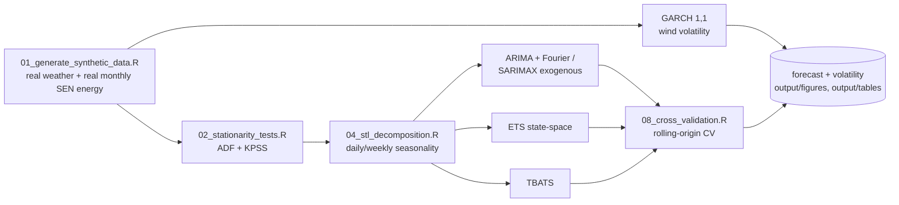
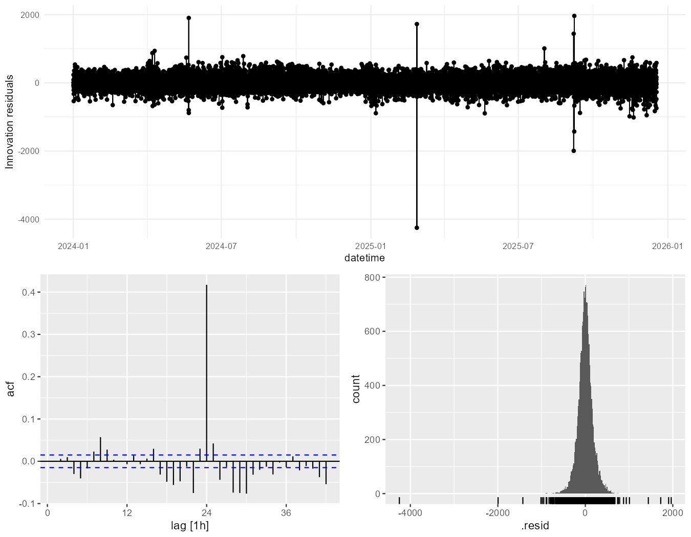
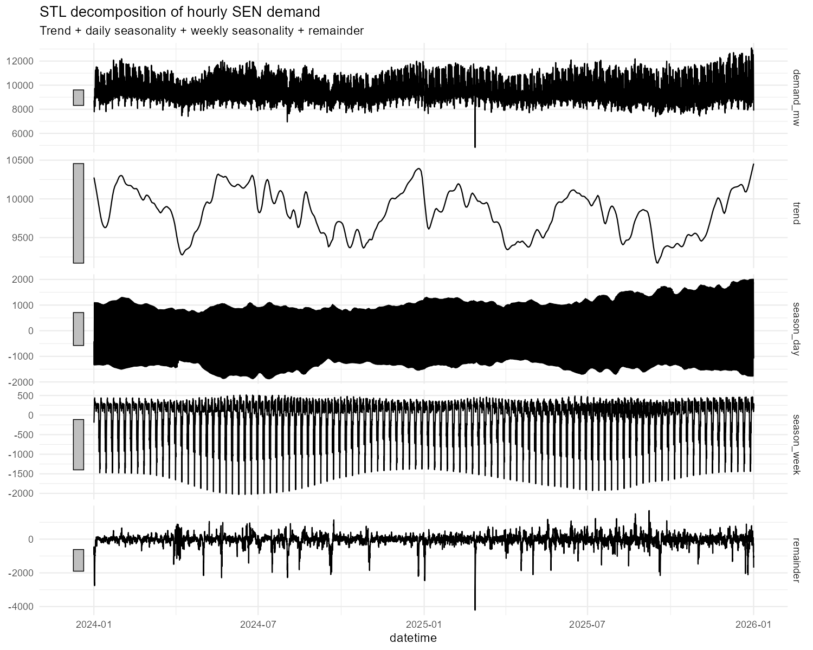
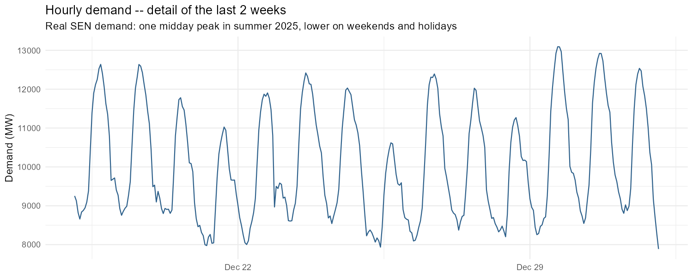
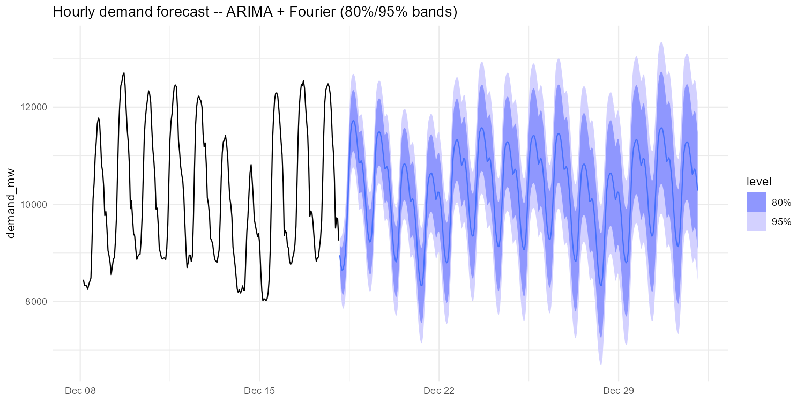

<div align="center">

# ⚡ Statistical Forecasting of Energy Demand and Grid Stability in Chile's SEN

**An end-to-end R project -- ARIMA/SARIMAX, STL decomposition, state space models (ETS), and GARCH -- on the tidyverts/fable ecosystem**

🌐 **[Español](README.es.md)** | **[English](README.md)**

[](https://www.r-project.org/)
[](https://fable.tidyverts.org/)
[](https://cran.r-project.org/package=forecast)
[](https://cran.r-project.org/package=rugarch)
[](LICENSE)

</div>

---

## 1. Project title

**Statistical Forecasting of Energy Demand and Grid Stability in Chile's Sistema Eléctrico Nacional (SEN)**

Repository: [`chile-energy-grid-forecasting-r`](https://github.com/Rxyxs/chile-energy-grid-forecasting-r)

## 2. Motivation

I'm drawn to this problem because it combines two things that rarely coexist in a single dataset: genuine multi-seasonal time series (daily, weekly, annual) and a volatility component that matters operationally, not just statistically. Chile's Coordinador Eléctrico Nacional (CEN) is responsible for real-time coordination and long-term planning of the SEN, which supplies the large majority of continental Chile. Two structural tensions make rigorous forecasting matter there:

- **Growing solar and wind penetration.** Chile has some of the highest solar irradiance in the world (Atacama) and an expanding wind fleet, especially in the north and south. That generation is intermittent by nature: it drops to zero overnight (solar) and varies with wind gusts that cluster in time (volatility clustering), not independently hour to hour.
- **Grid failure cost isn't linear.** A poorly anticipated net-demand ramp (the classic "duck curve" problem: net demand spikes sharply as solar output falls off in the evening) forces fast-ramping reserves to activate on short notice, and in the worst case leads to frequency imbalance.

This project builds the full statistical stack to address both problems with the right tool for each: ARIMA/SARIMAX and state-space models for the expected level of demand, and an explicit GARCH model for renewable-generation volatility -- not as a cosmetic add-on, but as the piece that connects level forecasting to actual grid-stability risk.

### 2.1 Business Impact & Key Performance Indicators

| Metric | Result | What it means |
|---|---|---|
| Best hourly demand forecast (TBATS) | 4.28% MAPE, 468 RMSE | 1.6x more accurate than the seasonal-naive baseline (6.73% MAPE) |
| Net-demand forecast with solar/wind exogenous (SARIMAX) | RMSE 800 vs. 1,080 naive, MASE 0.66 | Beats naive on RMSE and MASE; its MAPE (23%) is inflated by midday hours where real solar pushes net demand to the floor (§7.1) |
| Daily demand, rolling-origin CV (ETS vs. naive) | 0.77% vs. 1.38% MAPE | ETS also wins the single 28-day holdout now (2.22% vs. 3.85%) |
| GARCH(1,1) on hourly wind ramps | α₁ 0.010, β₁ 0.989, persistence 0.999 | Real wind-ramp volatility clusters for days; fitted on real (ERA5-driven) wind, not on a simulated GARCH |
| Residual lag-24 autocorrelation, best fix found | 0.388 → 0.347 (Fourier K=12) | A partial fix; TBATS, which fixed most of it on the old simulated series, no longer helps (§7.3) |

### 2.2 Pipeline Architecture



## 3. Theoretical framework

### 3.1 ARIMA and SARIMAX

An ARIMA(p,d,q) model combines autoregression (AR), differencing (I, "integrated"), and moving average (MA):

$$\left(1 - \sum_{i=1}^{p} \phi_i L^i\right)(1-L)^d y_t = \left(1 + \sum_{j=1}^{q} \theta_j L^j\right)\varepsilon_t$$

where $L$ is the lag operator ($Ly_t = y_{t-1}$), $\phi_i$ are the autoregressive coefficients, $\theta_j$ the moving-average coefficients, and $\varepsilon_t$ is white noise. SARIMAX extends this by adding exogenous regressors $X_t$:

$$y_t = \beta X_t + \left(1 - \sum \phi_i L^i\right)^{-1}\left(1 + \sum \theta_j L^j\right)(1-L)^{-d}\varepsilon_t$$

Rather than a classic seasonal SARIMA with period 168 (computationally infeasible over ~17,500 hourly observations), this project captures daily and weekly seasonality via **Fourier terms** as regressors within the ARIMA component -- the standard recommended approach for high-frequency series with multiple seasonal periods (Hyndman & Athanasopoulos, *Forecasting: Principles and Practice*).

### 3.1.1 TBATS

TBATS (Trigonometric seasonality, Box-Cox transformation, ARMA errors, Trend, Seasonal components -- De Livera, Hyndman & Snyder, 2011) is a state-space alternative to regression-based Fourier terms: each seasonal component is a **state that evolves over time**, not a fixed-amplitude sinusoid, and the model jointly estimates its own Box-Cox transform and an ARMA(p,q) correction on the errors:

$$y_t^{(\omega)} = \ell_{t-1} + \phi b_{t-1} + \sum_{i=1}^{T} s_{t-m_i}^{(i)} + d_t, \qquad d_t = \sum_{i=1}^{p}\varphi_i d_{t-i} + \sum_{j=1}^{q}\theta_j \varepsilon_{t-j} + \varepsilon_t$$

where $y_t^{(\omega)}$ is the Box-Cox-transformed series, $\ell_t$ the level, $b_t$ the damped trend, and each $s_t^{(i)}$ a seasonal state at period $m_i$ (here $m_1=24$, $m_2=168$). §7.3 measures directly why this matters here: the fixed-amplitude Fourier regressors above leave residual autocorrelation at lag 24 that TBATS's dynamic states reduce substantially further.

### 3.2 STL decomposition

STL (*Seasonal-Trend decomposition using Loess*) decomposes the series into trend, seasonal component(s), and remainder:

$$y_t = T_t + S_t^{(24)} + S_t^{(168)} + R_t$$

using iterative local regression (Loess) to estimate each component without assuming a fixed functional form -- unlike a pure sinusoidal fit, STL lets the seasonal shape drift slowly over time.

### 3.3 State space models (ETS)

ETS (Error-Trend-Seasonal) is a family of **innovations state space models**, not an ARIMA in disguise: each model is specified by its Error, Trend, and Seasonal type (additive, multiplicative, or none). The general case with state $\mathbf{x}_t$ follows:

$$y_t = w(\mathbf{x}_{t-1}) + r(\mathbf{x}_{t-1})\varepsilon_t \qquad \mathbf{x}_t = f(\mathbf{x}_{t-1}) + g(\mathbf{x}_{t-1})\varepsilon_t$$

with level, trend, and seasonality updated every period via weighted exponential-smoothing equations, rather than estimated once over the whole sample.

### 3.4 GARCH for volatility

GARCH(1,1) models the conditional variance of a series that exhibits volatility clustering -- calm and turbulent periods that group together in time, typical of wind generation (correlated gusts):

$$\varepsilon_t = \sigma_t z_t, \quad z_t \sim N(0,1) \qquad \sigma_t^2 = \omega + \alpha_1 \varepsilon_{t-1}^2 + \beta_1 \sigma_{t-1}^2$$

with $\omega > 0$, $\alpha_1, \beta_1 \geq 0$, and $\alpha_1 + \beta_1 < 1$ for variance stationarity. $\alpha_1 + \beta_1$ close to 1 indicates high persistence (volatility shocks that take a long time to dissipate).

## 4. Explanation

### 4.1 Data flow

```
R/01_generate_synthetic_data.R   →  data/sen_hourly.csv (anchored to data/real/)
        (dplyr-based generator)      (demand, solar, wind, net demand)
              ↓
R/02_data_wrangling.R            →  data/hourly_tsibble.rds
        (tsibble + fill_gaps)        data/daily_tsibble.rds
              ↓
R/03_stationarity_tests.R        →  output/tables/stationarity_tests.csv
R/04_stl_decomposition.R         →  output/figures/stl_*.png
              ↓
R/05_models_arima_sarimax.R      →  output/models/{arima_fourier,sarimax,tbats}_fit.rds
R/06_models_ets_statespace.R     →  output/models/ets_fit.rds
R/07_models_garch_volatility.R   →  output/models/garch_wind_fit.rds
              ↓
R/08_cross_validation.R          →  output/tables/accuracy_*.csv (incl. rolling-origin CV, hourly + daily)
R/09_generate_plots.R            →  output/figures/{forecast,residuals}_*.png
              ↓
reports/02_Residual_Autocorrelation_Fourier.Rmd  →  reports/02_..._Fourier.html
        (rendered separately -- see §6.1)
```

`run_pipeline.R` runs all 9 scripts in order, each as an **independent `Rscript` subprocess** (not via `source()`) -- a deliberate design choice, not a cosmetic one: every script has an `if (sys.nframe() == 0) { ... }` guard that only triggers when the script runs as a top-level process (`Rscript file.R`), and does **not** fire if the file were loaded via `source()` from another script. The first version of the orchestrator used `source()` and failed silently -- it produced no output files and threw no error -- exactly the kind of bug that only surfaces when running the full pipeline end to end, not when testing each script individually.

### 4.2 tidyverse/tsibble data manipulation

All manipulation uses `dplyr` + `tsibble`, the tidy data structure for time series: each row is an observation, each column a variable, and the time index (`datetime` or `date`) is registered as table metadata, not just another column. This lets `fill_gaps()`, `stretch_tsibble()` (for CV), and `feasts`/`fable` functions operate automatically on the correct time grain without the analyst manually managing indices.

### 4.3 Cross-validation logic

`stretch_tsibble(.init, .step)` generates multiple forecast "origins" with an expanding training window (rolling-origin cross-validation, the time-series standard -- unlike k-fold, it never trains on data that lies in the future relative to the forecast point). See §7 for a concrete finding on why this matters more than a single train/test split.

## 5. Methodology

### 5.1 Stationarity tests (ADF, KPSS)

ADF (H0: unit root / non-stationary) and KPSS (H0: stationary) are run together because they have opposite null hypotheses -- actual result from this project:

| Series | ADF (stat, p) | ADF conclusion | KPSS (stat, p) | KPSS conclusion |
|---|---|---|---|---|
| Hourly demand (level) | -17.38, 0.01 | Stationary | 0.50, 0.041 | **Non-stationary** |
| Hourly demand (1st diff.) | -24.30, 0.01 | Stationary | 0.000, 0.10 | Stationary |
| Hourly net demand (level) | -16.11, 0.01 | Stationary | 3.49, 0.01 | **Non-stationary** |
| Daily mean demand (level) | -3.50, 0.042 | Stationary | 0.44, 0.059 | Stationary |
| Daily mean demand (1st diff.) | -8.65, 0.01 | Stationary | 0.24, 0.10 | Stationary |

**ADF and KPSS disagree on the level of hourly demand and net demand** -- the textbook sign of trend-stationarity (stationary around a deterministic seasonal pattern, not in pure mean). Differencing once resolves it. With the real monthly scaling, daily mean demand is now borderline stationary in level (ADF p = 0.042, KPSS p = 0.059): the real SEN has little year-on-year trend over 2024-2025, unlike the old simulator's fixed 3% growth.

### 5.2 Multiple seasonality detection

STL decomposition (`season(period = "day") + season(period = "week")`) on hourly demand gives the following per-component variance:

| Component | Variance |
|---|---|
| Daily seasonality | 3,702,111 |
| Weekly seasonality | 397,113 |
| Trend | 71,510 |
| Remainder | 40,463 |

Daily seasonality dominates by a wide margin (the morning/evening double-peak shape). The trend's share fell sharply compared with the old simulated series (537,086): real monthly SEN energy moves much less over 2024-2025 than the simulator's growth trend plus annual cycle did.

### 5.3 Information criteria (AIC, BIC)

| Model | AIC | AICc | BIC |
|---|---|---|---|
| ARIMA + Fourier (demand) | 254,264 | 254,264 | 254,527 |
| SARIMAX (net demand, with solar/wind exogenous) | 258,131 | 258,131 | 258,410 |
| ETS(A,N,A) (daily demand) | 11,241.7 | 11,242.0 | 11,287.3 |

ETS now selects **additive** error and seasonality with **no trend**, where the old simulated series led it to ETS(M,A,M). That matches §5.1 and §5.2: once the monthly level follows real SEN generation, there is no persistent trend left for the model to carry.

### 5.4 Error metrics (MAPE, RMSE, MASE)

$$\text{MAPE} = \frac{100}{n}\sum \left|\frac{y_t - \hat{y}_t}{y_t}\right| \qquad \text{RMSE} = \sqrt{\frac{1}{n}\sum (y_t - \hat{y}_t)^2} \qquad \text{MASE} = \frac{\frac{1}{n}\sum |y_t - \hat{y}_t|}{\frac{1}{n-1}\sum |y_i - y_{i-1}|_{\text{train}}}$$

MASE > 1 means "worse than a naive forecast on the training set itself"; MASE < 1 means "better than that naive" -- a scale comparable across series of different magnitude, unlike RMSE.

## 6. Development (R code)

Modular pipeline under `R/`, built on `tidyverse` + `tsibble` + `fable` + `feasts` + `rugarch`. A few representative excerpts (real code from this repository, not illustrative):

**Explicit GARCH(1,1) simulation for the wind component in simulator mode** (`R/01_generate_synthetic_data.R`, `real = FALSE`) -- in the default real-anchored mode wind comes from real ERA5 wind speed instead (§7.2):

```r
simulate_garch11 <- function(n, omega, alpha, beta, seed) {
  set.seed(seed)
  sigma2 <- numeric(n); eps <- numeric(n)
  sigma2[1] <- omega / (1 - alpha - beta)
  eps[1] <- sqrt(sigma2[1]) * rnorm(1)
  for (t in 2:n) {
    sigma2[t] <- omega + alpha * eps[t - 1]^2 + beta * sigma2[t - 1]
    eps[t] <- sqrt(sigma2[t]) * rnorm(1)
  }
  list(eps = eps, sigma = sqrt(sigma2))
}
```

**ARIMA with Fourier terms** (`R/05_models_arima_sarimax.R`) -- `d = 1` fixed, informed by §5.1 (see the methodological notes below on two real `fable` limitations found in this project). `K = 12` in the daily term is the full Fourier basis for a 24-period cycle (Nyquist limit) -- raised from `K = 4` specifically to address the lag-24 residual autocorrelation in §7.3:

```r
fit_arima_fourier <- function(train_ts) {
  train_ts %>%
    model(
      arima_fourier = ARIMA(demand_mw ~ pdq(d = 1) +
                               fourier(period = "day", K = 12) +
                               fourier(period = "week", K = 2) + PDQ(0, 0, 0)),
      snaive_day = SNAIVE(demand_mw ~ lag("day"))
    )
}
```

**SARIMAX with renewable generation as exogenous regressor** (`R/05_models_arima_sarimax.R`) -- in real operation, the solar/wind forecast comes from an independent meteorological model and is treated as a known exogenous input when forecasting net demand:

```r
fit_sarimax_net_demand <- function(train_ts) {
  train_ts %>%
    model(
      sarimax = ARIMA(net_demand_mw ~ pdq(d = 1) + solar_mw + wind_mw +
                         fourier(period = "day", K = 12) +
                         fourier(period = "week", K = 2) + PDQ(0, 0, 0)),
      snaive_net = SNAIVE(net_demand_mw ~ lag("day"))
    )
}
```

**TBATS** (`R/05_models_arima_sarimax.R`) -- no exogenous-regressor support (so no SARIMAX analogue), fit only on `demand_mw`, via the `forecast` package's `msts`/`tbats`:

```r
fit_tbats_demand <- function(train_ts) {
  demand_msts <- forecast::msts(train_ts$demand_mw, seasonal.periods = c(24, 168))
  forecast::tbats(demand_msts, use.parallel = FALSE)
}
```

**Rolling-origin cross-validation, daily** (`R/08_cross_validation.R`):

```r
run_daily_rolling_cv <- function(daily_ts, init_size = 550, step = 14, horizon = 7) {
  daily_ts %>%
    stretch_tsibble(.init = init_size, .step = step) %>%
    model(ets = ETS(demand_mw_mean), snaive_week = SNAIVE(demand_mw_mean ~ lag("week"))) %>%
    forecast(h = horizon) %>%
    fabletools::accuracy(daily_ts)
}
```

**Rolling-origin cross-validation, hourly** (`R/08_cross_validation.R`, new) -- a **fixed-size** training window (not `stretch_tsibble`'s expanding one), so every origin is compared with the same amount of history, and a bounded number of origins so refitting a full ARIMA+Fourier search at every origin stays a matter of minutes, not hours:

```r
run_hourly_rolling_cv <- function(hourly_ts, init_size = 12000, step = 1000, horizon = 48, n_origins = 5) {
  # slides a fixed 12,000-hour training window forward `step` hours per origin,
  # refits ARIMA + Fourier (K=12) fresh each time, forecasts 48h ahead -- see §7.5
}
```

> **Methodological note -- a real bug found and its fix:** `fable::ARIMA()`'s (v0.5.0) automatic search for the differencing order `d` fails silently (an internal error with no message) on this series, on both R 4.4.0 and R 4.6.1 -- isolated by testing `stats::arima()` base R (works fine), then a grid of increasing complexity until finding that fixing `p,q` and leaving `d` to auto-search fails, but fixing `d` (or any complete order) and leaving `p,q` to auto-search works correctly. The fix isn't just a workaround: since `d=1` was already empirically justified by ADF/KPSS (§5.1), fixing it explicitly is *more* methodologically defensible than trusting an automatic black-box search.

> **Methodological note 2 -- the same class of bug, found again:** while chasing the lag-24 residual fix in §7.3, an explicit seasonal term at period 24 (`PDQ(P=1,D=0,Q=1,period=24)`, and separately `D=1` seasonal differencing at period 24) both failed with *"Could not find an appropriate ARIMA model... characteristic roots that may be numerically unstable"* -- the same failure signature as the `d`-search bug above, now confirmed on seasonal-order search too. Documented as a real, reproducible limitation of `fable::ARIMA()` on this series, not a specification error on this project's part; see `reports/02_Residual_Autocorrelation_Fourier.Rmd` for the full trail of what was tried.

### 6.1 Rendering the reproducible report

```powershell
Rscript run_pipeline.R    # must run first -- the report reads its saved models/tables
Rscript -e "rmarkdown::render('reports/02_Residual_Autocorrelation_Fourier.Rmd')"
```

`reports/02_Residual_Autocorrelation_Fourier.Rmd` is a standalone, fully reproducible R Markdown document (not just a script): it re-fits the original `K=4` baseline model itself (so the comparison isn't a number quoted from a past run), independently re-derives the true deterministic component of the series (with the same real monthly scaling) from the generator's own functions to check whether the residual autocorrelation is a modeling artifact or a real data property (§7.3 summarizes the answer), and renders ACF/PACF diagnostics for all three models plus the hourly rolling-origin CV table. Requires Pandoc (bundled with RStudio; `rmarkdown::pandoc_available()` checks). Output (`reports/*.html`) is gitignored, same as every other generated artifact in this repository -- rendering it is part of reproducing the project, not a tracked deliverable.

## 7. Results

### 7.1 Model accuracy comparison

**Fixed hourly holdout (14 days) -- demand:**

| Model | MAPE | RMSE | MASE |
|---|---|---|---|
| **TBATS** | **4.28%** | **468** | **0.67** |
| ARIMA + Fourier (K=12) | 4.54% | 574 | 0.76 |
| SNAIVE (daily seasonal naive) | 6.73% | 905 | 1.08 |

TBATS is the most accurate point forecaster, ahead of ARIMA+Fourier. The trade-off (§6) is that it doesn't support exogenous regressors and takes several times longer to fit.

**Fixed hourly holdout (14 days) -- net demand (SARIMAX, K=12):**

| Model | MAPE | RMSE | MASE |
|---|---|---|---|
| **SARIMAX** (solar+wind exogenous) | 22.96% | **800** | **0.66** |
| SNAIVE | **12.33%** | 1,080 | 0.76 |

**The metrics disagree, and it is MAPE that misleads here.** SARIMAX has lower RMSE and MASE than the naive forecast, but a much higher MAPE. With real solar, net demand falls to the 1,200 MW floor around midday on sunny days (about 9% of hours over the two years); MAPE divides by that small actual value, so any error in those hours explodes. RMSE and MASE, which do not divide by the actual, are the metrics to trust for net demand.

**Fixed daily holdout (28 days) -- daily mean demand:**

| Model | MAPE | RMSE | MASE |
|---|---|---|---|
| **ETS(A,N,A)** | **2.22%** | **383** | **1.51** |
| Weekly SNAIVE | 3.85% | 501 | 2.54 |

**Rolling-origin cross-validation (13 origins, 7-day horizon) -- daily demand:**

| Model | MAPE | RMSE | MASE |
|---|---|---|---|
| **ETS(A,N,A)** | **0.77%** | **106.9** | **0.48** |
| Weekly SNAIVE | 1.38% | 195 | 0.85 |

ETS beats the weekly naive forecast on both the single 28-day holdout and rolling-origin CV. With the old simulated series, the single holdout favoured the naive forecast and only CV revealed ETS's advantage; with real monthly levels both agree, and CV still gives the more reliable estimate (13 origins instead of one window).

### 7.2 GARCH on real wind ramps

The old version simulated wind as an explicit GARCH(1,1) and checked that `rugarch` recovered the true parameters. With wind now driven by real ERA5 wind speed, there is no true parameter to recover; the question becomes what the real volatility looks like.

Fitting GARCH on the deviation of wind from its hourly mean (the old approach) degenerates on real wind (α₁ ≈ 0.92, β₁ ≈ 0.07): that series has lag-1 autocorrelation 0.936, because wind persists for hours, so the model is fitting the persistence of the *level* instead of the volatility. `R/07_models_garch_volatility.R` now fits on the hourly change in wind generation (the ramp), whose lag-1 autocorrelation is 0.302:

| Parameter | Estimate |
|---|---|
| $\alpha_1$ | 0.010 |
| $\beta_1$ | 0.989 |
| Persistence ($\alpha_1+\beta_1$) | 0.999 |

Volatility of real wind ramps is almost integrated: a stormy, high-volatility period stays volatile for days, and shocks barely decay. The 48-hour-ahead conditional volatility forecast is about 394 MW/h. Persistence this close to 1 also hints that part of the clustering is seasonal (windier months), which a plain GARCH(1,1) does not model separately.

### 7.3 Residual diagnostics -- the lag-24 investigation

The ARIMA + Fourier residual ACF shows a notable spike at lag 24, from daily seasonality the model does not fully capture. Full detail and reproducible code: `reports/02_Residual_Autocorrelation_Fourier.Rmd` (re-rendered on the anchored series).

**Step 1 -- is this the data, or the model?** Hourly demand is built as a known deterministic function (trend × weekday × annual × daily shape) plus independent Gaussian noise, and each month is then scaled to real SEN energy. Reconstructing that deterministic part, with the same monthly factors, and subtracting it leaves the scaled noise, which should be white: **ACF(lag24) = 0.004, Ljung-Box p = 0.757** (does not reject white noise). The spike in the fitted model is a modeling artifact, not a missed signal.

**Step 2 -- fixes tried:**

| # | Attempt | Result | Verdict |
|---|---|---|---|
| 1 | Daily Fourier `K`: 4 → 12 (Nyquist limit for period 24) | ACF(lag24): 0.388 → 0.347 | Real, partial improvement (-10.6%) |
| 2 | Weekly Fourier `K`: 2 → 6/12/20 (with daily K=12) | ACF(lag24) worsened (old simulated series) | Discarded |
| 3 | `log(demand_mw)` instead of level | No improvement (old simulated series) | Discarded |
| 4 | `PDQ(P=1,D=0,Q=1,period=24)`, no daily Fourier | `fable::ARIMA()` fails: unstable characteristic roots | Unavailable (Methodological note 2, §6) |
| 5 | Seasonal differencing `D=1` at period 24 | Same failure as #4 | Unavailable |
| 6 | TBATS (dynamic seasonal states, no Fourier/differencing) | ACF(lag24) = 0.398 | No improvement on the anchored series |

Rows 1 and 6 are recomputed from the saved models every time the report renders; rows 2-5 come from exploratory fits on the old simulated series that are not part of the numbered pipeline.

**TBATS no longer helps.** On the old simulated series it cut the spike by 61% (to 0.159). On the anchored series it leaves it at 0.398, slightly above the K=4 baseline. The monthly scaling to real SEN energy shifts the level of the series from one month to the next, and TBATS's dynamic states absorb those level shifts rather than the daily shape. It remains the most accurate point forecaster (§7.1).

**Bottom line: no fix tried eliminates the autocorrelation** -- Ljung-Box still rejects white noise at lag 24 for all models. `K=12` gives the only improvement that holds and keeps SARIMAX exogenous-regressor support. Both `arima_fourier` (K=12) and TBATS are shipped in `output/models/`: Fourier for regressors, speed and the smaller residual spike; TBATS for headline accuracy.



**How to read it**: the three panels are the residual series, its ACF and its distribution. The spike at lag 24 in the middle panel is the whole subject of this section -- it is what survives after the daily Fourier basis is taken to its Nyquist limit. The residuals are otherwise centred and roughly symmetric. A model can be unbiased and still be leaving structure on the table, and only the ACF shows it.

The TBATS residual ACF and PACF are in `output/figures/tbats_residuals_acf.png` and `tbats_residuals_pacf.png`.

### 7.4 Generated figures



The decomposition separates the series into trend, daily season, weekly season and remainder. Two things are worth reading off it. The trend panel moves within about 9,000-10,250 MW, highest in winter (June-July) and early summer, with visible jumps at month boundaries: those are the monthly scaling to real SEN energy, and they are also why TBATS stops helping in §7.3. And the `season_day` panel is a *solid black band* — at two years of hourly resolution there are roughly 730 daily cycles on the page, so the individual shape is impossible to see. That is exactly why the next figure exists:



At two weeks the real shape appears: a double peak each weekday (morning and evening) separated by a midday dip, with weekends visibly lower and flatter. The double peak is what makes `K=4` insufficient as a daily Fourier basis — four harmonics cannot represent two peaks per cycle plus the asymmetry between them, which is the mechanism behind the lag-24 residual spike that §7.3 is about.



Ten days of training context followed by fourteen days forecast. The model keeps the double-peak shape through the whole horizon. Note the asymmetry of the bands: they are tight around the peaks and much wider around the overnight troughs, so the forecast is considerably less certain about how low demand goes at night than about how high it goes during the day.

All figures live in `output/figures/`, produced by `R/04_stl_decomposition.R` and `R/09_generate_plots.R`:

**A note for anyone regenerating these.** The figure labels are in English because `README.md` is the document GitHub shows by default and both language versions embed the same PNGs. The date axis needed more than translating strings: `ggplot2` formats it with the generating machine’s locale, so on an `es-CL` install it came out as `sept. 21`. Both plotting scripts now pin `Sys.setlocale("LC_TIME", "C")` — the same class of leak that invariant formatting prevents in file I/O.

- `stl_decomposition.png` -- trend + daily seasonal + weekly seasonal + remainder decomposition
- `demand_two_week_zoom.png` -- 2-week detail (the full decomposition at 2 years of hourly resolution looks like a solid band; this plot shows the actual double-peak shape)
- `stl_acf_demand.png`, `stl_acf_remainder.png`, `stl_pacf_demand.png` -- ACF/PACF
- `forecast_arima_demand.png`, `forecast_ets_daily.png` -- forecasts with 80%/95% uncertainty bands
- `residuals_arima.png`, `residuals_ets.png` -- residual diagnostics
- `garch_wind_volatility_forecast.png` -- 48-hour-ahead conditional volatility forecast
- `tbats_residuals_acf.png`, `tbats_residuals_pacf.png` -- generated by `reports/02_Residual_Autocorrelation_Fourier.Rmd`, not the numbered pipeline (§6.1)

### 7.5 Hourly rolling-origin cross-validation

Extends §7.1's fixed hourly holdout with `run_hourly_rolling_cv()` (`R/08_cross_validation.R`): a **fixed** 12,000-hour (~500-day) training window slid forward across 5 origins (1,000-hour steps), refitting ARIMA + Fourier (K=12) fresh each time, forecasting 48 hours ahead:

| Origin | MAPE | RMSE | MASE | Fit time |
|---|---|---|---|---|
| 1 | 4.62% | 621 | 0.801 | 81s |
| 2 | 4.50% | 599 | 0.816 | 68s |
| 3 | 3.87% | 497 | 0.668 | 75s |
| 4 | 4.96% | 604 | 0.824 | 83s |
| 5 | 3.45% | 468 | 0.562 | 67s |

MAPE ranges from 3.45% to 4.96% (mean 4.28%) with no steady drift: on the anchored series the error depends on which 48 hours are forecast (real weather and month), not on how late the origin is. A fixed-size window (not `stretch_tsibble`'s expanding one) is deliberate here: it isolates whether performance changes with *time*, not just with more training data.

## 8. Conclusion

All three level models (ARIMA+Fourier, SARIMAX, ETS) beat their naive baselines on the scale-free metric that matters (MASE < 1 on the hourly holdouts and on daily rolling-origin CV). Anchoring the series to real data changed several conclusions, and each change is reported rather than smoothed over: ETS now wins the single holdout as well as CV, MAPE turns out to be the wrong metric for net demand once real solar drives it to the floor, GARCH has to be fitted on wind ramps rather than wind deviations, and TBATS no longer fixes the lag-24 residual spike.

**Value for SEN operators:** a net-demand forecast with renewable exogenous inputs (SARIMAX) plus an explicit wind-ramp volatility model (GARCH) gives two complementary inputs a grid operator needs: *how much* energy is expected to be needed, and *how uncertain* the ramps tied to renewable generation are -- the latter is precisely what informs how much fast-ramping reserve to keep on hand.

**Limitations and future work:**
- The hour-to-hour demand profile is still simulated; only its monthly energy is real. Real hourly SEN demand is published by the Coordinador but requires an institutional account (§Data).
- Neither `K=12` Fourier nor TBATS eliminates the lag-24 residual autocorrelation (§7.3); a hand-rolled seasonal ARMA correction is the natural next attempt.
- The SARIMAX backtest uses the actual solar/wind values for the holdout period, not a forecast of them; in production, weather-forecast error would propagate into the net-demand forecast.
- GARCH persistence of 0.999 suggests seasonal volatility; a GARCH with seasonal variance terms (or fitted per season) would separate the two.

## Appendix: setup and usage

Requires R 4.4+ (tested on 4.4.0 and 4.6.1).

```powershell
git clone https://github.com/Rxyxs/chile-energy-grid-forecasting-r.git
cd chile-energy-grid-forecasting-r
Rscript R/00_setup.R      # installs tidyverse, tsibble, fable, feasts, forecast, rugarch, tseries, ggtime, rmarkdown
Rscript run_pipeline.R    # runs all 9 steps end to end (TBATS + hourly rolling CV add ~15-20 min)
Rscript -e "rmarkdown::render('reports/02_Residual_Autocorrelation_Fourier.Rmd')"  # optional, §6.1
```

### Running the tests

`tests/testthat/` covers the pure data-generation and wrangling functions (`R/01_generate_synthetic_data.R`, `R/02_data_wrangling.R`) that don't require a fitted model: GARCH(1,1) simulation stationarity/reproducibility, the daily demand-shape profile, simulator invariants (net demand, no negative generation, solar off at night), real-mode monthly energy matching the real SEN figures, and hourly/daily tsibble aggregation (gap-filling, correct grouping and totals).

```powershell
Rscript -e "install.packages('testthat', repos='https://cloud.r-project.org')"  # once
Rscript tests/testthat.R
```

### Repository structure

```
chile-energy-grid-forecasting-r/
├── R/
│   ├── 00_setup.R                      # package installation
│   ├── 01_generate_synthetic_data.R    # SEN series anchored to real data (simulator kept as real = FALSE)
│   ├── 02_data_wrangling.R             # hourly + daily tsibbles
│   ├── 03_stationarity_tests.R         # ADF, KPSS
│   ├── 04_stl_decomposition.R          # multi-seasonal STL + plots
│   ├── 05_models_arima_sarimax.R       # ARIMA + Fourier (K=12), SARIMAX, TBATS
│   ├── 06_models_ets_statespace.R      # ETS (state space)
│   ├── 07_models_garch_volatility.R    # GARCH(1,1) on wind volatility
│   ├── 08_cross_validation.R           # holdout + rolling-origin CV (daily + hourly), MAPE/RMSE/MASE
│   └── 09_generate_plots.R             # residuals, forecast bands, volatility
├── reports/
│   └── 02_Residual_Autocorrelation_Fourier.Rmd  # lag-24 diagnosis, ACF/PACF, honest writeup (§6.1, §7.3)
├── tests/
│   ├── testthat.R                      # test runner (Rscript tests/testthat.R)
│   └── testthat/                       # unit tests for data generation + wrangling
├── run_pipeline.R                      # orchestrator (Rscript subprocesses)
├── data/                               # CSVs + .rds tsibbles (generated, gitignored)
├── output/
│   ├── models/                         # fitted .rds models, incl. tbats_fit.rds (generated)
│   ├── tables/                         # .csv result tables, incl. accuracy_rolling_cv_hourly.csv (generated)
│   └── figures/                        # .png plots (generated)
├── .gitignore
├── LICENSE
├── README.md
└── README.es.md
```

### Data disclaimer

**What is real.** Hourly weather at five SEN substations (Open-Meteo, ERA5 reanalysis: solar irradiance and 100 m wind speed) and monthly SEN gross generation by technology (datos.gob.cl, CNE, plant-level), both versioned in `data/real/`. Solar and wind follow the real hourly weather, and the energy of every month (solar, wind and total) equals the real SEN figure; wind is capped at the installed 5.5 GW.

**What is simulated.** The hour-to-hour demand profile (double peak, weekday factors, noise) and the 1,200 MW must-run floor on net demand. The Coordinador Eléctrico Nacional publishes real hourly data, but its API requires an institutional account and its website blocks automated downloads, so it is not used here. `generate_sen_data(..., real = FALSE)` still produces the original fully simulated series.

## Author

**Pablo Reyes** -- Data Scientist, Universidad Mayor -- [github.com/Rxyxs](https://github.com/Rxyxs)
